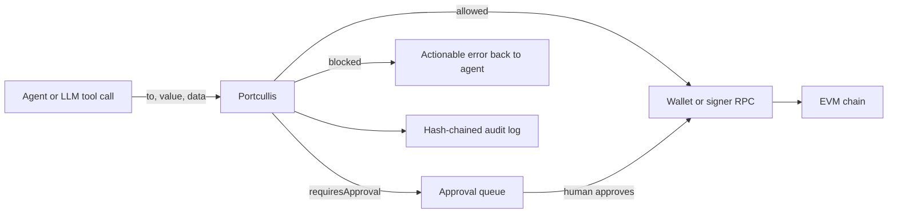
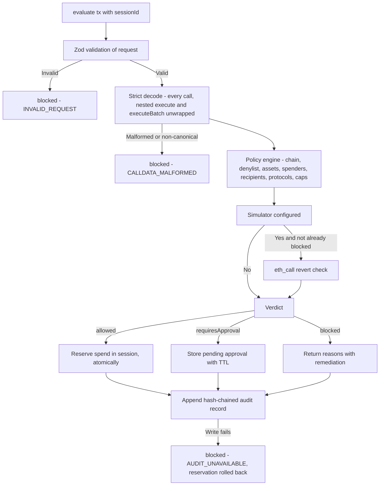
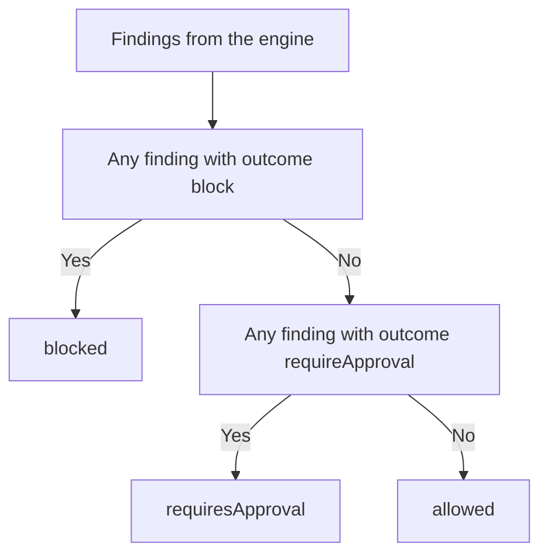
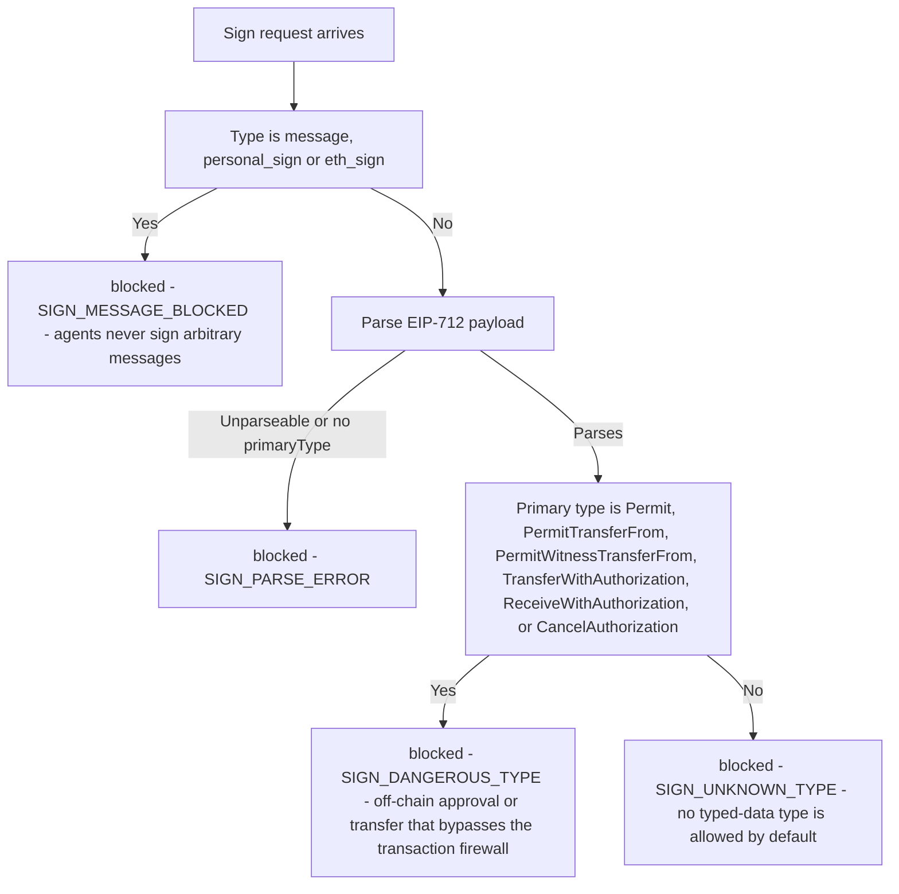
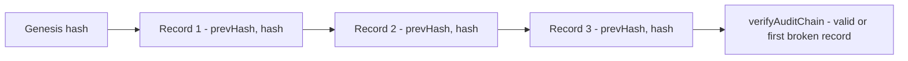
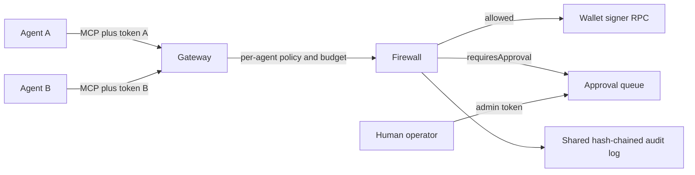

# Portcullis

> Most agent value moves as ERC-20 calldata with `value = 0`. A gate that only looks at native ETH value sees a $5M USDC transfer, an unlimited `approve`, or a `setApprovalForAll` to a drainer as a harmless zero-value call. This firewall decodes the calldata first, and decides second.

[](LICENSE)
[](https://nodejs.org/)
[](https://www.typescriptlang.org/)
[](package.json)
[](tests/)
[](https://github.com/SRIVISHNUGV-DEV/portcullis)

---

A pre-execution safety and risk gate for autonomous onchain agents. Every EVM transaction an agent proposes is decoded down to the asset level, checked against a deterministic policy, explained in plain English, and recorded in a hash-chained audit log — **before** it reaches the wallet. No network calls on the decision path, no randomness, no oracle: the same input always gives the same verdict, which is what makes decisions reviewable and testable.

Portcullis is deliberately small, and that is where its elegance lies: a single deterministic policy engine defines every verdict, the CLI, the MCP tools, and the gateway all call the same functions, so there is no second implementation of the rules to drift, and the only runtime dependency is `zod`. Verdicts travel as plain JSON; the audit log is hash-chained.

```ts
const verdict = await firewall.evaluate(tx, { sessionId: 'run-42' });
// verdict.verdict: "allowed" | "blocked" | "requiresApproval"
// verdict.summary: one-line plain-English explanation, with full addresses
```

> An agent proposes an unlimited USDC approval to a denylisted spender. The firewall decodes it, finds the allowance is at or above 2¹²⁸ (effectively a blank cheque) and the spender is denylisted, and returns `blocked` with risk score 100 (critical) — before any signature exists. A different proposal, a 100 USDC transfer inside its caps, returns `allowed` with risk score 0 in under a millisecond. Both verdicts are frozen, JSON-serializable, and appended to the same hash-chained audit log.

**Install from source** (the package is not on npm — verified: the registry returns 404):

```sh
git clone https://github.com/SRIVISHNUGV-DEV/portcullis.git
cd portcullis
npm ci
npm run check   # typecheck + tests + build to dist/
```

---

> [!WARNING]
> **Read this first — honest status, not marketing.**
>
> - **Version 0.1.0, early software.** No independent security audit is claimed. No CI runs on this repository (there is no workflow file in the tree) — the test numbers below were measured by running the suite, not read off a badge.
> - **Not on npm.** Install from source as above.
> - **A library and a gateway, not a wallet.** It has no keys, no custody, and no built-in Coinbase, Privy, or Safe integration. The built-in wallet backend is a JSON-RPC signer; other signers integrate by wrapping their send function (see [Wallet integrations](#wallet-integrations)).
> - **Enforcement is a deployment property.** The firewall is only a boundary if the agent cannot reach the wallet any other way. Run it in the service that holds the wallet credentials, not inside the same sandbox as the agent. Keep wallet-native controls (Safe guards, provider policy engines, on-chain session limits) as a second layer.

---

## Contents

- [Where it sits](#where-it-sits)
- [How a request is evaluated](#how-a-request-is-evaluated)
- [Verdicts and risk score](#verdicts-and-risk-score)
- [The sign gate: typed data and messages](#the-sign-gate-typed-data-and-messages)
- [What it decodes](#what-it-decodes)
- [Policy](#policy)
- [Reason codes](#reason-codes)
- [Sessions, approvals and reservations](#sessions-approvals-and-reservations)
- [Audit log](#audit-log)
- [Wallet integrations](#wallet-integrations)
- [MCP gateway for multiple agents](#mcp-gateway-for-multiple-agents)
- [Latency, measured](#latency-measured)
- [Run it](#run-it)
- [Command line](#command-line)
- [API reference](#api-reference)
- [Extending: custom stores and sinks](#extending-custom-stores-and-sinks)
- [Production checklist](#production-checklist)
- [Security model and limitations](#security-model-and-limitations)
- [What this is not](#what-this-is-not)
- [Development](#development)
- [License](#license)

---

## Where it sits



The firewall sits between the agent and the signer, in one of two shapes: as a library wrapping your send function (`guard()`), or as an MCP gateway that holds wallet access and serves many agents. In both shapes the rule is the same — if the agent can call the signer directly, the firewall is decoration, not a boundary.

---

## How a request is evaluated

`evaluate()` never throws. Every failure path yields a `blocked` verdict, and a failed audit write rolls the reservation back — the decision never exists without its audit record.



The engine is a **pure function** of `(request, policy, session usage, time)`. The only I/O is the optional simulator, the session store, and the audit sink — and a failure in any of them blocks the request.

### A real run

Measured against the built `dist/` on this machine, with a policy capping USDC at 1,000 per transaction and 5,000 per session, review above 500, and a denylist:

| Proposal | Verdict | Risk | Why |
|---|---|---|---|
| Transfer 100 USDC inside limits | `allowed` | 0, low | Within every rule |
| Transfer 600 USDC, above the review threshold | `requiresApproval` | 30, medium | `TOKEN_APPROVAL_THRESHOLD` |
| Unlimited USDC approval to a denylisted spender | `blocked` | 100, critical | `UNLIMITED_APPROVAL`, `UNTRUSTED_SPENDER`, `DENYLISTED_ADDRESS` |
| Unknown contract, unknown calldata | `requiresApproval` | 60, high | `UNKNOWN_CONTRACT_CALL` — never auto-allowed, but not a hard block by default |
| Malformed request, bad `from` address | `blocked` | 90, critical | `INVALID_REQUEST` — and `evaluate()` still did not throw |

Note the fourth row carefully: unknown calls default to human review, not to a block. For unattended agents, set `unknownContractCalls`, `unlistedAssets`, and `recipients.notAllowlisted` to `'block'` (see [Production checklist](#production-checklist)).

---

## Verdicts and risk score

```jsonc
{
  "verdict": "blocked",
  "allowed": false,
  "riskScore": 100, "riskLevel": "critical",
  "summary": "BLOCKED — The agent wants to grant 0x8888… an UNLIMITED allowance for USDC (0x8335…) — it could move the entire balance at any time without another agent transaction. Blocked because: Unlimited allowance for USDC (0x8335…) to 0x8888…: the spender could drain the full balance at any time.",
  "reasons": [
    { "code": "UNLIMITED_APPROVAL", "outcome": "block", "severity": "critical",
      "remediation": "Approve only the exact amount the next operation needs" },
    { "code": "UNTRUSTED_SPENDER", "outcome": "requireApproval", "severity": "high" }
  ],
  "spend": { "native": "0", "tokens": {} },
  "txDigest": "…", "policyHash": "…", "auditHash": "…", "durationMs": 0.795
}
```

(Addresses are shortened here for layout only. Real summaries print **full addresses**, because shortened forms are what address-poisoning attacks imitate.)

| Verdict | Meaning | What to do |
|---|---|---|
| `allowed` | Within every rule. Spend is **reserved** against the session. | Send, then `commit(verdict, { txHash })`. |
| `requiresApproval` | No hard violation, but a human must confirm (threshold, unknown contract, untrusted spender, …). | Show `summary`/`reasons`; call `approve(verdict, { approver })` or `reject`. |
| `blocked` | A hard rule failed, or the firewall could not evaluate safely. | Return `reasons[].remediation` to the agent. |

How the verdict is chosen — this is the whole decision rule, from `verdictOf()`:



**Risk score** ranks severity for reviewers and **never** changes the verdict. Severity weights are low 10, medium 30, high 60, critical 90. Sort descending: the largest counts fully, each next one adds `weight × 0.4^i`, capped at 100. Levels: ≥ 80 critical, ≥ 55 high, ≥ 25 medium, otherwise low. Example: one `UNLIMITED_APPROVAL` (90) plus one `UNTRUSTED_SPENDER` (60) → 90 + 24 = 114, capped to 100 (critical).

---

## The sign gate: typed data and messages

Transactions are only half the attack surface. An off-chain signature — an EIP-2612 permit, a Permit2 `SignatureTransfer`, an EIP-3009 authorization — can authorize a transfer without any transaction ever passing through the firewall. The gateway closes that path with a separate, deliberately coarse sign gate (`evaluateSignRequest()`, exposed to agents as `check_sign_typed_data` and `check_sign_message`).



Measured live: `personal_sign`, an EIP-712 `Permit`, and an unknown `MyCustomOrder` type are all `blocked`, each with its own reason code.

> [!IMPORTANT]
> **This gate is coarse v1, by the code's own comment.** It blocks every typed-data type and every personal-sign request; it does not yet decode Permit fields and apply token approval limits to them — that field-level evaluation is the stated P1 follow-up. What v1 buys you is the closure of the disqualifying hole: no signature type slips through unexamined. And the gate only works if signing is routed through it: the gateway's MCP instructions require agents to call `check_sign_typed_data` / `check_sign_message` before any wallet signing call, and the gateway is the only path to the wallet. An agent with direct signer access bypasses it exactly like it bypasses the transaction firewall.

Related limitation, stated in the decoder itself: Permit2 `SignatureTransfer` (`permitTransferFrom`) has no agent-initiated on-chain leg — a third party calls Permit2 with the signature — so the transaction decoder never sees it. The sign gate is the mitigation, not an afterthought: route signing through it, or the off-chain path stays open.

---

## What it decodes

Decoding is **canonical-only**. The strict ABI codec re-encodes every decoded call and requires a byte-for-byte match, so dirty address bits, trailing bytes, odd offsets, and non-zero padding are blocked rather than interpreted. A recognized selector with bad arguments is never downgraded to an "unknown call".

| Category | Functions | Treatment |
|---|---|---|
| Native | Value with empty calldata; value attached to any call | Summed across all calls against native caps |
| ERC-20 movement | `transfer`, `transferFrom` (including pulls from third parties), ERC-677 `transferAndCall`, EIP-3009 `transferWithAuthorization` | Counted against token caps |
| ERC-20 authority | `approve`, `increaseAllowance`, EIP-2612 `permit`, Permit2 `approve` (canonical address only) | Unlimited (≥ 2¹²⁸) → **blocked**; finite → counted against caps; spender must be trusted |
| Revocations | `approve(…, 0)`, `decreaseAllowance`, `setApprovalForAll(…, false)` | Allowed |
| NFTs | ERC-721 `transferFrom` / `safeTransferFrom` / `approve`, ERC-1155 single / batch transfers, `setApprovalForAll` | Collection rules; operator approvals to untrusted operators blocked by default |
| Smart-wallet wrappers | `execute(address,uint256,bytes)` and `executeBatch((address,uint256,bytes)[])` called on the agent's own wallet | Unwrapped recursively (depth-limited, default max depth 2); other self-calls → **blocked** |
| Other | Unknown selectors, fallback calls, contract deployment | Policy modes (defaults: unknown calls → approval, unlisted assets → approval, deployment → blocked) |

`transferFrom` and `approve` share selectors between ERC-20 and ERC-721. Contracts listed in `nfts` are decoded as ERC-721; everything else is treated as ERC-20, and unlisted contracts go through the `unlistedAssets` rule with the ambiguity stated in the explanation.

---

## Policy

Policies are validated with strict Zod schemas at startup. Unknown keys, overlaps (an address configured as both a token and a protocol) and allow/deny conflicts throw `PolicyValidationError` — fail fast, at construction, not at the first transaction. Amounts are base units (`bigint`, decimal string, or hex string); `parseUnits` converts human amounts. Addresses are normalized to lowercase.

```ts
const policy = definePolicy({
  version: 1,
  chainIds: [8453],
  native: { perTransactionMax: parseUnits('0.05', 18), sessionMax: parseUnits('0.2', 18), requireApprovalAbove: parseUnits('0.02', 18) },
  tokens: [
    { address: USDC, symbol: 'USDC', decimals: 6,
      perTransactionMax: parseUnits('500', 6), sessionMax: parseUnits('2000', 6),
      requireApprovalAbove: parseUnits('100', 6), maxApproval: parseUnits('500', 6) },
    { address: WETH, symbol: 'WETH', decimals: 18, perTransactionMax: parseUnits('0.1', 18), sessionMax: parseUnits('0.5', 18),
      allowedFunctions: ['0xd0e30db0', '0x2e1a7d4d'] }, // deposit(), withdraw(uint256)
  ],
  protocols: [{ name: 'Uniswap SwapRouter02', address: ROUTER, selectors: ['0x04e45aaf'], maxNativeValue: parseUnits('0.05', 18) }],
  approvals: { spenders: [PERMIT2_ADDRESS], unknownSpender: 'requireApproval', operatorApprovals: 'block' },
  recipients: { allow: [TREASURY, VENDOR], notAllowlisted: 'requireApproval' },
  denylist: [KNOWN_DRAINER],
  unlistedAssets: 'requireApproval',
  unknownContractCalls: 'requireApproval',
  contractDeployment: 'block',
  session: { maxDurationSeconds: 3600, maxTransactions: 50 },
  limits: { maxCalls: 16, maxNestingDepth: 2, maxCalldataBytes: 131072 },
  approvalTtlSeconds: 900,
});
```

Accounting rules worth knowing:

- **Per-transaction caps apply to the whole request.** Batched or nested calls are summed, so splitting one transfer into many calls doesn't evade the cap.
- **Finite approvals count as spend when granted.** Once approved, a spender (router, Permit2, marketplace) can move the funds without another agent transaction, so the grant is the last point the firewall can enforce. Re-approving the same spender is counted again; this is deliberately conservative.
- **Third-party pulls count.** `transferFrom` and EIP-3009 transfers out of a treasury count against limits even though the funds don't leave the agent wallet.
- Allowlisted protocols are trusted spenders automatically. Tokens and collections cannot also be protocols, because unrestricted selectors would bypass their limits; use `allowedFunctions` instead.

### Policy reference

Amounts accept `bigint`, a base-unit decimal string, a `0x` hex string, or a safe integer. A `Mode` is `'block'` or `'requireApproval'`.

| Field | Type | Default | Meaning |
|---|---|---|---|
| `version` | `1` | required | Schema version. |
| `name` | string | — | Label shown in logs. |
| `chainIds` | chain ID[] | required | Chains this policy accepts; anything else → `CHAIN_NOT_ALLOWED`. |
| `native.symbol` | string | `'ETH'` | Display symbol. |
| `native.perTransactionMax` | amount | required | Max native value per request, summed across all calls. |
| `native.sessionMax` | amount | required | Max native value per session (committed + reserved). |
| `native.requireApprovalAbove` | amount | — | Within caps but above this → human approval. |
| `tokens[]` | TokenRule | `[]` | Configured ERC-20s (see below). |
| `nfts[]` | NftRule | `[]` | Configured ERC-721/1155 collections. |
| `protocols[]` | ProtocolRule | `[]` | Allowlisted contracts the agent may call. |
| `approvals.spenders` | address[] | `[]` | Trusted spenders/operators. Protocol addresses are trusted automatically. |
| `approvals.unknownSpender` | Mode | `'requireApproval'` | Approval to a spender not trusted. |
| `approvals.operatorApprovals` | Mode | `'block'` | `setApprovalForAll(operator, true)` to an untrusted operator. |
| `recipients.allow` | address[] | — | If set, transfers to other addresses aren't automatically allowed. |
| `recipients.notAllowlisted` | Mode | `'requireApproval'` | Transfer to an address not in `recipients.allow`. |
| `denylist` | address[] | `[]` | Any interaction with these → blocked. Can't overlap trusted lists. |
| `unlistedAssets` | Mode | `'requireApproval'` | Token or collection not configured. |
| `unknownContractCalls` | Mode | `'requireApproval'` | Non-allowlisted contract, unrecognized function, or disallowed selector. |
| `contractDeployment` | Mode | `'block'` | Calls with no `to` (contract creation). |
| `session.maxDurationSeconds` | int | — | Session older than this → `SESSION_EXPIRED`. |
| `session.maxTransactions` | int | — | Max allowed/approved requests per session. |
| `limits.maxCalls` | 1–256 | `16` | Max effective calls after unwrapping. |
| `limits.maxNestingDepth` | 0–4 | `2` | Max `execute`/`executeBatch` nesting. |
| `limits.maxCalldataBytes` | 4–1 048 576 | `131072` | Max calldata per call. |
| `approvalTtlSeconds` | 1–86 400 | `900` | How long a `requiresApproval` verdict can be approved. |
| `simulation.onUnavailable` | Mode | `'requireApproval'` | Simulator configured but couldn't simulate (RPC error, batch). |

**TokenRule**

| Field | Default | Meaning |
|---|---|---|
| `address`, `symbol`, `decimals` | required | Token identity. `decimals` is used only for display. |
| `perTransactionMax` | required | Max moved **or approved** per request (summed across a batch). |
| `sessionMax` | required | Max moved or approved per session, including reservations. |
| `requireApprovalAbove` | — | Above this (within caps) → human approval. |
| `maxApproval` | `perTransactionMax` | Largest single allowance grant. |
| `allowedFunctions` | `[]` | Extra selectors allowed on the token, e.g. WETH `deposit()` `0xd0e30db0`. |

**NftRule**: `address`, `name`, `standard` (`'erc721'` \| `'erc1155'`), `allowTransfers` (default `false`; when false, transfers out need approval).

**ProtocolRule**: `name`, `address`, `selectors` (omit to allow any function, at least one if set), `maxNativeValue` (max native value per call).

Validation rejects, with `PolicyValidationError`: unknown keys, an address configured twice (token, collection or protocol), and an address that is both denylisted and trusted.

---

## Reason codes

Each finding in `verdict.reasons` has a `code`, an `outcome` (`block`, `requireApproval` or `info`), a `severity`, a `message`, an optional `remediation` and a call `path`. "Mode" means the outcome comes from the policy field shown. Treat the `code` strings as the stable contract; message wording may change.

| Code | Outcome | Severity | Trigger |
|---|---|---|---|
| `INVALID_REQUEST` | block | critical | Request failed schema validation. |
| `INVALID_SESSION_ID` | block | critical | Session ID isn't 1–128 chars of `[A-Za-z0-9_.:@-]`. |
| `EVALUATION_ERROR` | block | critical | Any internal exception (fail closed). |
| `AUDIT_UNAVAILABLE` | block | critical | Audit write failed; reservation rolled back. |
| `CHAIN_NOT_ALLOWED` | block | critical | `chainId` not in `chainIds`. |
| `DENYLISTED_ADDRESS` | block | critical | Target, recipient, spender or owner is denylisted. |
| `CALLDATA_MALFORMED` | block | critical | Known selector with bad or non-canonical arguments. |
| `CALLDATA_TOO_LARGE` | block | critical | Calldata over `limits.maxCalldataBytes`. |
| `TOO_MANY_CALLS` | block | critical | More than `limits.maxCalls` effective calls. |
| `NESTING_TOO_DEEP` | block | critical | Wallet wrappers nested deeper than `limits.maxNestingDepth`. |
| `WALLET_SELF_CALL` | block | critical | Call to the agent's own wallet that isn't `execute`/`executeBatch`. |
| `UNLIMITED_APPROVAL` | block | critical | Allowance ≥ 2¹²⁸. |
| `APPROVAL_EXCEEDS_MAX` | block | high | Allowance above `maxApproval`. |
| `NATIVE_PER_TX_LIMIT` / `TOKEN_PER_TX_LIMIT` | block | high | Request total over `perTransactionMax`. |
| `NATIVE_SESSION_LIMIT` / `TOKEN_SESSION_LIMIT` | block | high | Session total would exceed `sessionMax`. |
| `SESSION_EXPIRED` | block | high | Session older than `session.maxDurationSeconds`. |
| `SESSION_TX_LIMIT` | block | high | `session.maxTransactions` reached. |
| `PROTOCOL_VALUE_EXCEEDED` | block | high | Native value over a protocol's `maxNativeValue`. |
| `SIMULATION_REVERTED` | block | critical | `eth_call` reverted. |
| `OPERATOR_APPROVAL` | mode `approvals.operatorApprovals` | critical | `setApprovalForAll(…, true)` to an untrusted operator. |
| `CONTRACT_DEPLOYMENT` | mode `contractDeployment` | critical | Contract creation. |
| `UNTRUSTED_SPENDER` | mode `approvals.unknownSpender` | high | Approval to an untrusted spender. |
| `RECIPIENT_NOT_ALLOWLISTED` | mode `recipients.notAllowlisted` | high | Recipient not in `recipients.allow`. |
| `UNLISTED_ASSET` | mode `unlistedAssets` | high | Token/collection not configured. |
| `UNKNOWN_CONTRACT_CALL` | mode `unknownContractCalls` | high | Call to a contract that isn't allowlisted. |
| `UNRECOGNIZED_TOKEN_FUNCTION` | mode `unknownContractCalls` | high | Function on a token that isn't a transfer/approval or in `allowedFunctions`. |
| `PROTOCOL_FUNCTION_NOT_ALLOWED` | mode `unknownContractCalls` | high | Selector not in a protocol's `selectors`. |
| `SIMULATION_UNAVAILABLE` | mode `simulation.onUnavailable` | medium | Simulator couldn't run. |
| `BURN_ADDRESS_RECIPIENT` | requireApproval | high | Transfer to the zero address. |
| `NATIVE_APPROVAL_THRESHOLD` / `TOKEN_APPROVAL_THRESHOLD` | requireApproval | medium | Above `requireApprovalAbove`. |
| `NFT_TRANSFER_NOT_PREAPPROVED` | requireApproval | medium | Transfer from a collection with `allowTransfers: false`. |
| `THIRD_PARTY_SOURCE` / `THIRD_PARTY_OWNER` | info | medium | Funds pulled from, or an approval granted on behalf of, an address other than `from`. |
| `ALLOWANCE_REVOKED` / `ALLOWANCE_DECREASED` / `OPERATOR_REVOKED` | info | low | Risk-reducing actions; always allowed. |

Sign-gate reason codes (from `evaluateSignRequest()`): `SIGN_MESSAGE_BLOCKED`, `SIGN_PARSE_ERROR`, `SIGN_DANGEROUS_TYPE`, `SIGN_UNKNOWN_TYPE` — all `blocked`.

---

## Sessions, approvals and reservations

A session is a budget scope (for example, one agent run): `evaluate(tx, { sessionId })`. It starts on first use.

1. An `allowed` evaluation atomically checks caps and **reserves** the spend, so concurrent requests can't both pass a cap that only one fits under.
2. After sending, call `commit(verdict, { txHash })`. If the send fails **and you know nothing was broadcast**, call `release(verdict)`. `guard()` does this automatically, and keeps the reservation on ambiguous errors such as timeouts unless `releaseOnError` says otherwise.
3. `approve(verdict, { approver, note })` is bound to the evaluated transaction digest, can be used once, expires after `approvalTtlSeconds`, and re-checks caps against current usage before reserving. Hard rules can't be approved away.

**Session IDs must come from trusted host code, never from the agent.** A new session starts with a fresh budget, so an agent that can name its own session can reset its caps. The MCP gateway never exposes the session to agents.

`MemorySessionStore` keeps state in memory only. `JournalSessionStore` keeps the same in-memory reads and writes every change to an append-only journal that is replayed and compacted on startup. The session lock covers only the in-memory decision. Writes are queued in lock order and **group-committed**: concurrent requests share one write and one `fsync`, and each call returns only after its own state and every earlier state are on disk. Both journals serve one process; for several instances, implement `SessionStore.transact()` with a real lock or compare-and-swap (Redis `WATCH`/`MULTI`, a database row lock), or give each agent to exactly one instance.

---

## Audit log

Every evaluation, approval, rejection, commit and release is appended as a SHA-256 hash-chained record containing the policy hash, transaction digest, normalized request, decoded actions, findings and verdict. No secrets are involved: inputs are public transaction fields. Measured live: a 5-record chain verifies as `{ valid: true }`.

```ts
import { JsonlFileAuditSink, verifyAuditChain } from 'portcullis';
const audit = new JsonlFileAuditSink('/var/log/agent-firewall/audit.jsonl', { fsync: true }); // continues the chain after restart
const firewall = createFirewall({ policy, audit });
verifyAuditChain(await JsonlFileAuditSink.read(audit.path)); // { valid: true } or the first broken record
```

`JsonlFileAuditSink` group-commits concurrent records (`fsync` defaults to `false` here; pass `true` to survive power loss). Several firewalls can share one chain by passing the same `AuditLog` instance as `audit`.

The chain makes edits, deletions and reordering **detectable**. Making them **impossible** needs WORM/object-lock storage, or periodically anchoring the head hash outside the host. The default in-memory sink is for development only and grows without bound. Implement `AuditSink` for your log pipeline; if `append` rejects, the request is blocked.



---

## Wallet integrations

`guard(send, options)` wraps any async send function. By default it reads `{ to, value, data }` or `{ calls: [...] }`; use `toCalls` for other shapes. The examples below are integration patterns: check each vendor SDK's current types. Nothing here is a built-in vendor backend — the only built-in signer is the gateway's `JsonRpcWallet`, which sends through any JSON-RPC endpoint.

```ts
// viem / Coinbase AgentKit-style wallet providers ({ to, value, data } in, hash out)
const send = guard((tx) => walletClient.sendTransaction({ account, chain, ...tx }), { firewall, chainId: 8453, from: account.address });

// Safe (Protocol Kit): gate the batch before creating the Safe transaction
const propose = guard((txs) => safe.createTransaction({ transactions: txs }), {
  firewall, chainId: 8453, from: safeAddress, toCalls: (txs) => txs,
});

// Privy, Coinbase CDP or any other API: wrap the function your code already calls
const sendViaProvider = guard((tx) => provider.sendTransaction(tx), {
  firewall, chainId: 8453, from: agentWalletAddress,
  onApprovalRequired: async (verdict) => ((await askHuman(verdict.summary)) ? { approver: 'oncall@example.com' } : false),
  releaseOnError: (e) => isDefinitelyNotBroadcast(e),
});
```

For EIP-4337 or EIP-7702 smart accounts, evaluate the **inner calls** (`calls: [...]`) with `from` set to the account address. Calls the agent makes to its own account through `execute`/`executeBatch` are unwrapped automatically.

Optional simulation: `createFirewall({ simulator: createRpcSimulator({ url }) })` runs an `eth_call` revert check only for requests that aren't already blocked. Reverts are blocked; RPC failures and batches apply `policy.simulation.onUnavailable` (default `requireApproval`, simulator timeout 1500 ms). Treat RPC URLs containing API keys as secrets.

---

## MCP gateway for multiple agents

`portcullis/mcp` turns the firewall into the **only path to the wallet**: a gateway that holds wallet access, serves any number of agents over the [Model Context Protocol](https://modelcontextprotocol.io), and sends only what the firewall allows.



- **Per agent:** bearer token (only its SHA-256 is stored, compared in constant time), wallet address, policy and budget. An agent can't see another agent's requests.
- **Tools — exactly these seven, as implemented in `src/mcp.ts`:** `get_budget`, `approve_token`, `send_transaction`, `check_transaction` (dry run, same arguments as `send_transaction`), `get_request_status`, `check_sign_typed_data`, `check_sign_message`. There is deliberately **no tool that approves a request**: escalations are decided over the admin API with a separate token, so a prompt-injected agent can't clear its own escalation.
- **Transports:** Streamable HTTP (`POST /mcp`, JSON responses) for many agents, or stdio for one local agent. Requests carrying a browser `Origin` header are refused.
- **Admin API:** `GET /healthz`, `GET /admin/pending`, `POST /admin/requests/:id/approve|reject` with `{ "approver", "note"? }`, `GET /admin/audit/verify` — admin token only.
- **Wallet backend:** `JsonRpcWallet` sends through any signer that accepts `eth_sendTransaction` (local node, Clef, Web3Signer, a fork), one transaction at a time per sender so nonces never race. Implement `WalletBackend` for Coinbase, Privy, Safe or a KMS signer.
- **Outcomes:** `executed`, `checked`, `blocked`, `pending_approval`, `rejected`, `expired`, `failed` (wallet refused before broadcast; budget released) and `unknown` (for example a timeout; budget stays reserved).
- **Storage:** with `storage.dir` configured, sessions live in `sessions.jsonl` and the audit log in `audit.jsonl` under that directory (created mode `0700`, `fsync` default `true`). Without `storage`, budgets and the audit log are in memory, and the gateway refuses to start when `NODE_ENV=production`.

```jsonc
// gateway.json — amounts are base-unit strings
{
  "chainId": 8453,
  "rpcUrl": "http://127.0.0.1:8545",
  "listen": { "host": "127.0.0.1", "port": 8787 },
  "adminTokenSha256": "<sha256 of the admin token>",
  "storage": { "dir": "/var/lib/agent-firewall", "fsync": true },
  "agents": [
    { "id": "payments-bot", "tokenSha256": "<sha256>", "wallet": "0x…", "policy": { "version": 1, "chainIds": [8453], "…": "…" } }
  ]
}
```

```sh
npx transaction-firewall token                                   # prints a new token and its SHA-256
npx transaction-firewall serve --config gateway.json             # HTTP MCP + admin API
npx transaction-firewall stdio --config gateway.json --agent payments-bot
```

MCP client config for an agent: `{ "mcpServers": { "wallet": { "type": "http", "url": "http://127.0.0.1:8787/mcp", "headers": { "Authorization": "Bearer <agent token>" } } } }`.

---

## Latency, measured

The firewall makes no network calls on the decision path. Measured by running `npm run bench` on this machine (the previous README's numbers came from a different machine and are not repeated here):

| Store | Single ERC-20 transfer p50 / p95 / p99 | 8-call batch p50 / p95 / p99 | 64 concurrent agents |
|---|---|---|---|
| In memory | 0.071 / 0.157 / 0.606 ms | 0.212 / 0.310 / 1.614 ms | 8,694 evals/s, p50 3.200 ms, p99 13.198 ms (queueing included) |
| File (journal + audit, no fsync) | 0.516 / 1.095 / 2.209 ms | 0.451 / 1.577 / 2.880 ms | 8,608 evals/s |
| File + fsync | 0.179 / 0.458 / 0.673 ms | 0.378 / 0.879 / 3.271 ms | 7,379 evals/s |

The fork-lab end-to-end claim from the previous README (20 agents on a Base mainnet fork, 200 transfers, 740-record chain) is **not** repeated here: it needs Foundry `anvil`, which is not installed on this machine, so it was not re-verified. `BENCH_MAX_P99_MS=1 npm run bench` fails if any non-fsync p99 exceeds 1 ms.

---

## Run it

```sh
npm install
npm run check   # typecheck + tests + build
```

```ts
import { createFirewall, guard, parseUnits } from 'portcullis';

const firewall = createFirewall({ policy: {
  version: 1, chainIds: [8453],
  native: { perTransactionMax: parseUnits('0.05', 18), sessionMax: parseUnits('0.2', 18) },
  tokens: [{ address: USDC, symbol: 'USDC', decimals: 6, perTransactionMax: parseUnits('500', 6), sessionMax: parseUnits('2000', 6) }],
}});
const send = guard((tx) => wallet.sendTransaction(tx), { firewall, chainId: 8453, from: wallet.address });
await send({ to: USDC, data }); // throws FirewallBlockedError / ApprovalRequiredError, or sends
```

Use `firewall.evaluate(tx)` directly when you want the verdict without sending anything (dry runs, agent self-checks, approval UIs). `evaluate()` never throws; `approve()`, `reject()`, `commit()` and `release()` throw `FirewallStateError` on misuse (wrong verdict type, unknown or reused reservation/approval, expired window).

### Walkthroughs

**Dry run and human approval.** `evaluate()` returns a frozen verdict; show `summary` and `reasons` to an operator, then `approve(verdict, { approver })` (re-checks caps, bound to `txDigest`, single-use, expires after `approvalTtlSeconds`) or `reject(verdict, { approver })`. An approved verdict can still come back `blocked` if the session budget was used up while waiting.

**Batches and smart accounts.** Every call is decoded, token amounts are **summed across the batch** for per-transaction caps, and `execute`/`executeBatch` calls on `from` itself are unwrapped up to `limits.maxNestingDepth`.

**Budget.** `firewall.usage('run-42')` returns `{ createdAt, txCount, spent: { native, tokens }, pendingApprovals }`; `spent` includes committed spend and outstanding reservations, in base units. If you decide not to send, call `firewall.release(verdict)`; if you send, call `firewall.commit(verdict, { txHash })`.

**Wrap a send function.** `guard()` returns a function with the same signature as `send`. Returning `verdict.summary` and the remediations to the LLM lets the agent correct itself (for example, approve an exact amount instead of an unlimited one). `ApprovalRequiredError` carries the pending verdict's `requestId`; without an `onApprovalRequired` handler it is thrown instead of auto-approving.

---

## Command line

The same binary (`transaction-firewall`, from `dist/cli.js` after `npm run build`) also works as a one-shot developer CLI. Every command maps to a real library function — there are no stubs, and no second implementation of the rules. It takes JSON files: policies use base-unit strings for amounts (exactly like `gateway.json`), transactions use `{ chainId, from, to?, value?, data? }` or `{ chainId, from, calls: [...] }`.

| Command | Calls | What it does |
|---|---|---|
| `evaluate --policy <file> --tx <file> [--session <id>] [--storage <dir>] [--json] [--out <file>]` | `createFirewall()` + `firewall.evaluate()` | Print the verdict (human summary, or full JSON with `--json`); `--out` writes the verdict JSON for the commands below |
| `approve --policy <file> --verdict <file> --approver <id> [--note <text>] --storage <dir> [--json] [--out <file>]` | `firewall.approve()` | Approve a `requiresApproval` verdict; re-checks caps, returns an `allowed` verdict with a reservation |
| `reject --policy <file> --verdict <file> --approver <id> [--note <text>] --storage <dir>` | `firewall.reject()` | Reject a pending approval permanently |
| `commit --policy <file> --verdict <file> [--tx-hash <hash>] --storage <dir>` | `firewall.commit()` | Turn an approved verdict's reservation into committed spend |
| `release --policy <file> --verdict <file> [--reason <text>] --storage <dir>` | `firewall.release()` | Return an un-sent verdict's reserved budget |
| `usage --policy <file> [--session <id>] --storage <dir> [--json]` | `firewall.usage()` | Session usage: transactions, committed + reserved spend, pending approvals |
| `decode --policy <file> --tx <file> [--json]` | `compilePolicy()` + `TransactionRequestSchema.parse()` + `decodeRequest()` | Show the decoded actions and decode issues without deciding anything |
| `sign-check --type typedData\|message (--payload <file> \| --payload-json <string>)` | `evaluateSignRequest()` | Run a signing request through the sign gate |
| `policy --policy <file> [--json]` | `compilePolicy()` | Validate a policy and print its hash and counts |
| `audit-verify --file <audit.jsonl> [--json]` | `JsonlFileAuditSink.read()` + `verifyAuditChain()` | Verify a hash-chained audit log, or name the first broken record |
| `token` | `hashToken()` | Print a new bearer token and its SHA-256 (for gateway configs) |
| `serve` / `stdio` | `Gateway` + MCP server | The long-running gateway (see [MCP gateway](#mcp-gateway-for-multiple-agents)) |

Exit codes are scriptable: **0** allowed / success, **1** blocked or error, **2** `requiresApproval`. So `evaluate` can gate a script — an allowed transaction passes, anything else stops it.

```sh
# Check a policy, then a transaction against it (from the repo root, after npm run build)
node dist/cli.js policy --policy policy.json
# policy valid
# hash: b9e5a3616aea23e3fc928440756ba24c5b960672463bdaa1d55cb2118d22c73a
# chains: 8453
# tokens: 1  nfts: 0  protocols: 0

node dist/cli.js evaluate --policy policy.json --tx tx.json
# verdict: requiresApproval (allowed: false)
# risk: 30 (medium)
# summary: NEEDS HUMAN APPROVAL — The agent wants to transfer 600 USDC to 0xa11ce00000000000000000000000000000000001. Review required because: 600 USDC is above the 500 USDC review threshold.
# (exit code 2)
```

**Stateful commands need `--storage`.** Reservations and pending approvals live in the session store, so a second process can only see them when both processes share a durable store. The pattern is: evaluate with `--storage <dir>` (which creates `sessions.jsonl` and `audit.jsonl` there, mode `0700`, fsync on), then approve / commit / release / usage against the same directory. Without `--storage`, each command runs against in-memory stores, and a later `approve` will correctly refuse with an explanation instead of silently approving nothing. Verdicts are plain JSON, so `--out verdict.json` from one command feeds `--verdict verdict.json` to the next:

```sh
node dist/cli.js evaluate --policy policy.json --tx tx.json --storage ./state --out pending.json
# exit 2: requiresApproval
node dist/cli.js approve --policy policy.json --verdict pending.json --approver alice@example.com --storage ./state --out approved.json
# verdict: allowed (allowed: true) ... reservationId: …
node dist/cli.js commit --policy policy.json --verdict approved.json --tx-hash 0xabc --storage ./state
# committed reservation …
node dist/cli.js usage --policy policy.json --storage ./state
# transactions: 1 ... spent tokens: 0x8335…: 600000000 ... pending approvals: 0
node dist/cli.js audit-verify --file ./state/audit.jsonl
# audit chain valid (2 records)
```

---

## API reference

Everything is exported from the package root, plus `portcullis/mcp` and `portcullis/gateway`.

| Member | Description |
|---|---|
| `createFirewall(options)` / `new Firewall(options)` | `options`: `policy` (input or compiled; invalid input throws `PolicyValidationError`), `audit?: AuditSink`, `sessions?: SessionStore`, `simulator?: Simulator`, `clock?: () => number`, `generateId?: () => string`. |
| `evaluate(tx, { sessionId? })` | Returns a `Verdict`. **Never throws.** `tx` is `{ chainId, from, to?, value?, data? }` or `{ chainId, from, calls: [{ to?, value?, data? }] }` (1–256 calls). Unknown fields such as `gas` and `nonce` are ignored. |
| `approve(verdict, { approver, note? })` | Approves a `requiresApproval` verdict and re-checks limits. Returns an `allowed` verdict with a reservation, or a `blocked` one. |
| `reject(verdict, { approver, note? })` | Rejects a pending approval permanently. |
| `commit(verdict, { txHash? })` | Turns the reservation into committed spend after sending. |
| `release(verdict, reason?)` | Returns the reserved budget when nothing was broadcast. |
| `usage(sessionId?)` | `{ createdAt, txCount, spent: { native, tokens }, pendingApprovals }`. |
| `policy`, `policyHash` | Compiled policy and its SHA-256 (recorded in every verdict and audit record). |
| `guard(send, options)` | Wraps a send function. Options: `firewall`, `chainId`, `from`, `toCalls?`, `sessionId?`, `onApprovalRequired?`, `onVerdict?`, `releaseOnError?`. Throws `FirewallBlockedError` or `ApprovalRequiredError`, each carrying `.verdict` and a stable `.code` (`FIREWALL_BLOCKED`, `FIREWALL_APPROVAL_REQUIRED`). |
| `definePolicy(input)` / `compilePolicy(input)` | Validate a policy up front (e.g. in CI); `compilePolicy` returns the indexed, hashed form. |
| `PolicySchema`, `TransactionRequestSchema` | The Zod schemas, for your own API validation. |
| `decodeRequest(...)` | Decoder only: calldata → actions and decode issues. |
| `evaluatePolicy(input)`, `riskScore(findings)` | Pure engine, no sessions or audit. |
| `describeAction(action)` | Plain-English text for one action. |
| `AuditLog`, `MemoryAuditSink`, `JsonlFileAuditSink`, `verifyAuditChain`, `GENESIS_HASH` | Audit logging and verification. |
| `MemorySessionStore`, `JournalSessionStore` | In-memory session store, and the same with a group-committed journal. |
| `GroupCommitFile` | Append-only line writer used by the durable stores. |
| `Gateway`, `createGatewayServer`, `serveStdio`, `handleMcpMessage`, `JsonRpcWallet`, `hashToken`, `evaluateSignRequest` | Gateway and MCP surface (see above). |
| `createRpcSimulator({ url, timeoutMs?, fetch? })` | `eth_call` revert check (default timeout 1500 ms; batches reported as unavailable). |
| `parseUnits`, `formatUnits`, `UINT256_MAX` | Amount helpers. |
| `SELECTORS`, `PERMIT2_ADDRESS`, `UNLIMITED_APPROVAL_THRESHOLD` | Constants used by the decoder. |

Verdicts are deep-frozen and JSON-serializable. Verdict fields: `requestId`, `sessionId`, `verdict`, `allowed`, `chainId`, `txDigest`, `policyHash`, `riskScore`, `riskLevel`, `reasons`, `actions` (amounts are base-unit strings), `summary`, `explanation`, `spend`, `reservationId`, `approvalExpiresAt`, `approval`, `evaluatedAt`, `durationMs`, `auditHash` (`null` if auditing failed).

---

## Extending: custom stores and sinks

### Session store

```ts
interface SessionStore {
  transact<T>(sessionId: string, now: number, fn: (state: SessionState) => T | Promise<T>): Promise<T>;
}
```

`transact` must load the session state (creating it with `createdAt = now` if missing), run `fn` while no other caller can touch that session, and persist the mutated state **only if `fn` resolves**. If `fn` throws, nothing may be saved. `SessionState` contains `bigint` values, so serialize them explicitly (for example as decimal strings). Typical implementations: a database row lock (`SELECT … FOR UPDATE`), Redis `WATCH`/`MULTI` with retry, or a per-session queue in a single owner process.

### Audit sink

```ts
interface AuditSink {
  append(record: AuditRecord): Promise<void>; // reject → the request is blocked
  tail?(): Promise<AuditRecord | undefined>;   // last record, to continue the chain after restart
  readonly pipelined?: boolean;                // see below
}
```

Set `pipelined: true` only if the sink persists overlapping `append` calls in call order and, after one rejects, rejects every later append until `tail()` is called. The log then prepares records while earlier writes are in flight, which lets the sink batch them.

`AuditRecord` is `{ seq, timestamp, type, requestId, sessionId, payload, prevHash, hash }`, where `type` is `evaluation`, `approval`, `rejection`, `commit` or `release`. Ship records to append-only storage (S3 Object Lock, a WORM bucket, a ledger table) and periodically publish the latest `hash` somewhere the host can't rewrite.

---

## Production checklist

- [ ] The agent process **cannot** reach wallet keys or wallet APIs except through the firewall (library) or the gateway (MCP).
- [ ] `unknownContractCalls`, `unlistedAssets` and `recipients.notAllowlisted` are set to `'block'` for unattended agents.
- [ ] Every token the agent should touch is in `tokens` with realistic `perTransactionMax` / `sessionMax`.
- [ ] Protocols list explicit `selectors`, never "any function".
- [ ] A durable, append-only `AuditSink` is configured, and its head hash is anchored externally.
- [ ] Sessions and the audit log are durable (`JournalSessionStore` + `JsonlFileAuditSink` with `fsync: true`, or the gateway's `storage.dir`); a shared, locking `SessionStore` is used if more than one instance serves the same agent.
- [ ] Session IDs are set by host code, never by the agent.
- [ ] `commit()` / `release()` are always called (or `guard()` is used), so reservations don't leak.
- [ ] Off-chain signing goes through the sign gate (`check_sign_typed_data` / `check_sign_message`) or is disabled for agents — and the gate's coarse-v1 limits are understood (see above).
- [ ] Wallet-native limits (Safe guards, provider policies, on-chain session caps) are in place as a second layer.
- [ ] Policies are validated in CI with `definePolicy()` and reviewed like code.

---

## Security model and limitations

- **The sign gate is coarse v1.** It blocks all typed data and all personal-sign requests; it does not yet decode Permit fields against token limits. That field-level evaluation is the code's stated P1 follow-up. Until then, a legitimate Permit flow must go through an equivalent on-chain approve/transfer so the transaction firewall can enforce limits on it.
- **Permit2 SignatureTransfer has no on-chain leg for the decoder.** A third party calls Permit2 with the signature; the transaction firewall never sees it. The sign gate is the mitigation — route signing through it.
- **No balance-diff simulation.** The engine judges declared intent from calldata; the optional `eth_call` check catches reverts, not hidden side effects. An allowlisted protocol can still move tokens within allowances already granted, which is why approvals are budgeted and spenders must be trusted.
- **Unknown calls are unverified by definition.** Their default is `requiresApproval`; use `'block'` for unattended agents.
- **USD-denominated limits are not built in.** Limits are per token in base units, which keeps decisions deterministic and oracle-free.
- **Protocol calldata is checked by target and selector only.** For an allowlisted protocol such as a Uniswap router, the firewall doesn't decode the arguments, so it doesn't check the swap recipient or the minimum output (slippage). Restrict protocols to the selectors you need and keep their approvals small.
- **Approval thresholds apply per transaction.** Splitting a payment into chunks below `requireApprovalAbove` isn't detected; only `sessionMax` bounds the total.
- **The defaults are in memory.** Use `JournalSessionStore` and a durable audit sink (or the gateway's `storage.dir`) in production. Both journals serve one process.
- This is a policy-enforcement layer, not a substitute for contract audits, key management or wallet-level controls.

---

## What this is not

- **Not a wallet or a signer.** It holds no keys and broadcasts nothing by itself; the gateway's `JsonRpcWallet` is the only built-in sending path, and it just forwards to a JSON-RPC endpoint you configure.
- **Not a vendor integration.** There are no built-in Coinbase, Privy, or Safe backends; those are `guard()` integration patterns.
- **Not a published package.** Version 0.1.0, install from source, no npm release, no CI badge to hide behind.
- **Not a chain service.** No hosted control plane, no oracle, no price feed, no account to sign up for.
- **Not a substitute for audits or key management.** It enforces the policy you write; it cannot fix a policy you wrote wrong, a compromised key, or a malicious contract you allowlisted.

What it *is*: a small, dependency-light (only `zod` at runtime), deterministic gate between an agent and a signer — kept readable so the policy it enforces can be reviewed like code.

---

## In flight, not on main

PR #2, open and unmerged — "Uniswap swap decoding, per-recipient windows, Zodiac Roles export" (`feat/swap-decoding-windows-zodiac`): adds `src/zodiac.ts` and `scripts/zodiac-fork.mjs` on top of this tree. Nothing from that branch is described above as shipped; this README describes `main` only.

---

## Development

Verified on this tree by running, not by reading badges:

| Command | Result on this machine |
|---|---|
| `npm run typecheck` | Passes (strict TypeScript: `exactOptionalPropertyTypes`, `noUncheckedIndexedAccess`) |
| `npm test` | Passes — **10 files, 123 tests, ~10.6 s** (ABI strictness, decoder, policy edge cases, concurrency, approvals, audit tampering, middleware, simulator, CLI) |
| `npm run build` | Passes — emits ESM + declarations to `dist/` |
| `npm run bench` | See [Latency, measured](#latency-measured) |
| `node scripts/fork-lab.mjs` | Not run here — needs Foundry `anvil`, which is not installed on this machine |

Requirements: Node.js 20 or later, ESM. The only runtime dependency is `zod`. ethers and viem are **not** required; amounts are plain `bigint`.

### Layout

```
src/abi.ts         strict canonical ABI codec
src/decoder.ts     calldata → asset-level actions
src/engine.ts      deterministic rules, limits, risk score, verdict
src/explain.ts     plain-English descriptions
src/firewall.ts    validation, reservations, approvals, fail-closed orchestration
src/middleware.ts  guard() wrapper and typed errors
src/session.ts     session store interface + in-memory implementation
src/storage.ts     group-commit writer and journaled session store
src/gateway.ts     multi-agent gateway: auth, wallet backends, approval queue, sign gate
src/mcp.ts         MCP server (stdio + HTTP) and admin API
src/cli.ts         transaction-firewall command
src/audit.ts       hash-chained audit log and sinks
src/simulation.ts  optional eth_call simulator
src/schemas.ts     Zod schemas for requests and policies
src/canonical.ts   canonicalization and hashing helpers
src/units.ts       amount helpers
tests/             10 files, 123 tests (including tests/cli.test.ts: the CLI, end to end)
scripts/bench.mjs  latency and throughput measurement
scripts/fork-lab.mjs  Base mainnet fork lab (needs anvil)
```

### Provenance

The decoding and scoring approach is derived from ATF's `packages/compiler/risk/calldata.ts` and `risk/scoring.ts` (token-aware decoding, unlimited-approval detection, dominant-signal score aggregation). It deliberately differs where those modules failed open: unknown or malformed calldata no longer falls back to native-value-only scoring, decoding is canonical-only, batches are aggregated, and multi-chain/ZK abstractions are removed.

---

## License

Licensed under the [Apache License 2.0](LICENSE). Copyright 2026 Corven Labs.

---

> Perfection is achieved, not when there is nothing more to add, but when there is nothing left to take away.
>
> — Antoine de Saint-Exupéry
