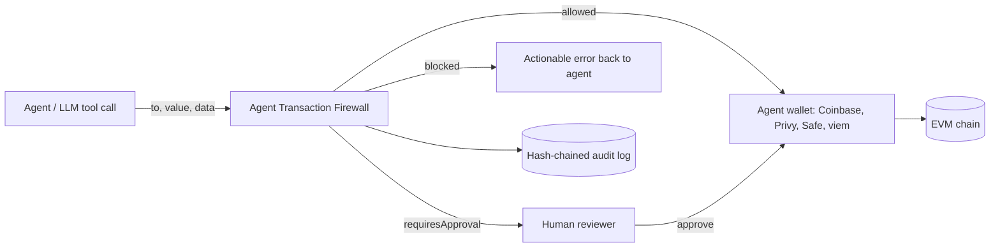
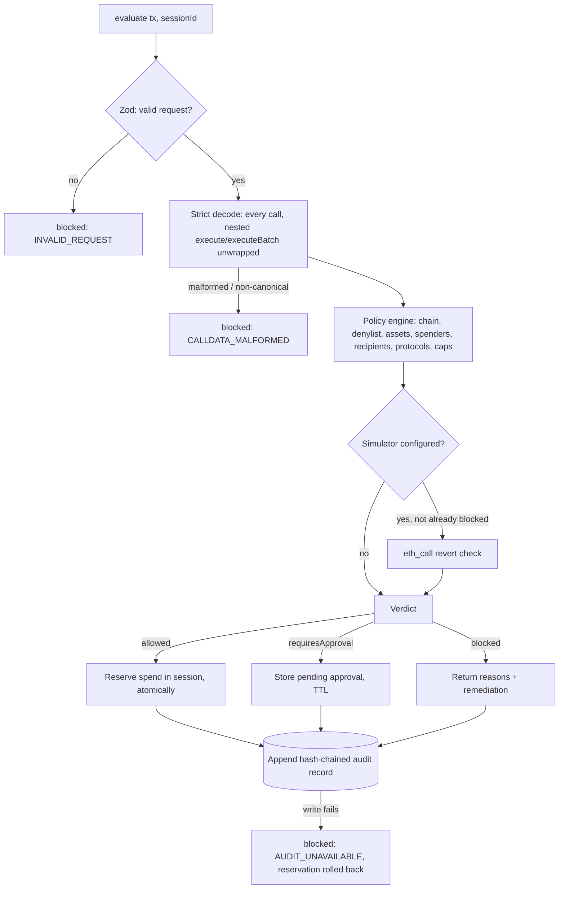
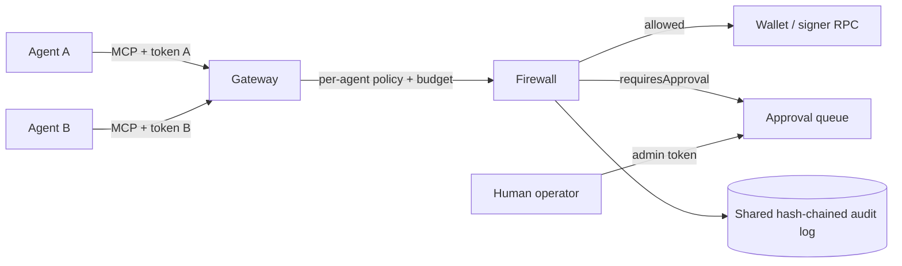

# Agent Transaction Firewall

A pre-execution safety and risk gate for autonomous onchain agents. Every EVM transaction an agent proposes is decoded down to the asset level, checked against a deterministic policy, explained in plain English, and recorded in a tamper-evident audit log **before** it reaches the agent wallet (Coinbase, Privy, Safe, viem, or any signer).

```
verdict: "allowed" | "blocked" | "requiresApproval"
```

**Why:** most agent value moves as ERC-20 calldata with `value = 0`. Gates that only look at native ETH value see a $5M USDC transfer, an unlimited `approve`, or `setApprovalForAll` to a drainer as a harmless zero-value call.

## Contents

- [Where it sits](#where-it-sits)
- [How a request is evaluated](#how-a-request-is-evaluated)
- [Installation](#installation)
- [Quick start](#quick-start)
- [Walkthroughs](#walkthroughs)
- [Verdicts](#verdicts)
- [What it decodes](#what-it-decodes)
- [Policy](#policy)
- [Policy reference](#policy-reference)
- [Reason codes](#reason-codes)
- [Risk score](#risk-score)
- [Sessions, approvals and reservations](#sessions-approvals-and-reservations)
- [Audit log](#audit-log)
- [Wallet integrations](#wallet-integrations)
- [MCP gateway for multiple agents](#mcp-gateway-for-multiple-agents)
- [Latency](#latency)
- [API reference](#api-reference)
- [Extending: custom stores and sinks](#extending-custom-stores-and-sinks)
- [Production checklist](#production-checklist)
- [Security model and limitations](#security-model-and-limitations)
- [FAQ](#faq)
- [Troubleshooting](#troubleshooting)
- [Development](#development)
- [License](#license)

## Where it sits



> **The firewall is only a boundary if the agent cannot reach the wallet any other way.** Run it in the service that holds the wallet credentials (signing service, API gateway, or MCP tool server), not inside the same sandbox as the agent's private key. Keep wallet-native controls (Safe guards, provider policy engines, onchain session limits) as a second layer.

## How a request is evaluated



The engine is a **pure function** of `(request, policy, session usage, time)`: no network, no randomness, no oracle. The same input always gives the same verdict, which is what makes decisions reviewable and testable. The only I/O is the optional simulator, the session store and the audit sink, and a failure in any of them blocks the request.

## Installation

The package isn't published to npm yet. Build it from source and install it into your project:

```sh
git clone https://github.com/SRIVISHNUGV-DEV/agent-transaction-firewall.git
cd agent-transaction-firewall
npm ci
npm run check          # typecheck + tests + build to dist/

# in your project
npm install ../agent-transaction-firewall
# or: npm pack here, then npm install ./agent-transaction-firewall-0.1.0.tgz
```

Requirements: Node.js 20 or later, ESM (`"type": "module"` or a bundler). The only runtime dependency is `zod`. ethers and viem are **not** required; amounts are plain `bigint`.

## Quick start

```sh
npm install
npm run check   # typecheck + tests + build
```

```ts
import { createFirewall, guard, parseUnits } from 'agent-transaction-firewall';

const firewall = createFirewall({ policy: {
  version: 1, chainIds: [8453],
  native: { perTransactionMax: parseUnits('0.05', 18), sessionMax: parseUnits('0.2', 18) },
  tokens: [{ address: USDC, symbol: 'USDC', decimals: 6, perTransactionMax: parseUnits('500', 6), sessionMax: parseUnits('2000', 6) }],
}});
const send = guard((tx) => wallet.sendTransaction(tx), { firewall, chainId: 8453, from: wallet.address });
await send({ to: USDC, data }); // throws FirewallBlockedError / ApprovalRequiredError, or sends
```

Use `firewall.evaluate(tx)` directly when you want the verdict without sending anything (dry runs, agent self-checks, approval UIs).

## Walkthroughs

All examples assume `USDC`, `TREASURY`, `wallet` and `agentWallet` are defined by your application.

### 1. Dry run: ask before you send

```ts
const verdict = await firewall.evaluate(
  { chainId: 8453, from: agentWallet, to: USDC, data: transferCalldata },
  { sessionId: 'run-42' },
);

console.log(verdict.verdict);   // "allowed" | "requiresApproval" | "blocked"
console.log(verdict.summary);   // one-line plain-English description
for (const r of verdict.reasons) console.log(r.code, r.outcome, r.message, r.remediation ?? '');
```

An `allowed` verdict **reserves** budget. If you decide not to send, call `firewall.release(verdict)`; if you send, call `firewall.commit(verdict, { txHash })`.

### 2. Human approval

```ts
const pending = await firewall.evaluate(tx, { sessionId: 'run-42' });

if (pending.verdict === 'requiresApproval') {
  // Show pending.summary and pending.reasons to an operator (Slack, dashboard, ...).
  const ok = await askOperator(pending.summary);
  if (!ok) {
    await firewall.reject(pending, { approver: 'alice@example.com', note: 'unexpected recipient' });
  } else {
    const approved = await firewall.approve(pending, { approver: 'alice@example.com' });
    if (approved.allowed) {
      const hash = await wallet.sendTransaction(tx);
      await firewall.commit(approved, { txHash: hash });
    }
    // approved.verdict can be "blocked" if the session budget was used up while waiting.
  }
}
```

Approvals are bound to `txDigest` (the exact normalized transaction), single-use and expire after `approvalTtlSeconds`. `approve()` throws `FirewallStateError` for an expired, unknown, already-decided or mismatched approval.

### 3. Batches and smart accounts

```ts
const verdict = await firewall.evaluate({
  chainId: 8453,
  from: smartAccount,
  calls: [
    { to: USDC, data: approveRouterCalldata },     // finite approval → counted as spend
    { to: ROUTER, data: swapCalldata, value: 0n }, // must be an allowlisted protocol + selector
  ],
});
```

Every call is decoded, token amounts are **summed across the batch** for per-transaction caps, and `execute`/`executeBatch` calls on `from` itself are unwrapped up to `limits.maxNestingDepth`.

### 4. Check remaining budget

```ts
const u = await firewall.usage('run-42');
// { createdAt, txCount, spent: { native: "…", tokens: { "0x8335…": "…" } }, pendingApprovals }
```

`spent` includes both committed spend and outstanding reservations, in base units.

### 5. Wrap a send function with `guard()`

```ts
import { guard, FirewallBlockedError, ApprovalRequiredError } from 'agent-transaction-firewall';

const send = guard((tx) => wallet.sendTransaction(tx), { firewall, chainId: 8453, from: agentWallet });

try {
  await send({ to: USDC, data });
} catch (e) {
  if (e instanceof FirewallBlockedError) return { error: e.verdict.summary, fix: e.verdict.reasons.map((r) => r.remediation) };
  if (e instanceof ApprovalRequiredError) return { pending: e.verdict.requestId };
  throw e; // the wallet itself failed
}
```

Returning `e.verdict.summary` and the remediations to the LLM lets the agent correct itself (for example, approve an exact amount instead of an unlimited one).

## Verdicts

```jsonc
{
  "verdict": "blocked",
  "allowed": false,
  "riskScore": 100, "riskLevel": "critical",
  "summary": "BLOCKED — The agent wants to grant 0x8888… an UNLIMITED allowance for USDC (0x8335…) — it could move the entire balance at any time without another agent transaction. Blocked because: Unlimited allowance for USDC (0x8335…) to 0x8888…: the spender could drain the full balance at any time.",
  "reasons": [
    { "code": "UNLIMITED_APPROVAL", "outcome": "block", "severity": "critical", "path": "0",
      "message": "…", "remediation": "Approve only the exact amount the next operation needs" },
    { "code": "UNTRUSTED_SPENDER", "outcome": "requireApproval", "severity": "high", "path": "0", "message": "…" }
  ],
  "actions": [{ "type": "token_approval", "token": "0x8335…", "spender": "0x8888…", "amount": "115792…", "unlimited": true }],
  "spend": { "native": "0", "tokens": {} },
  "txDigest": "…", "policyHash": "…", "auditHash": "…", "durationMs": 0.09
}
```

(Addresses are shortened here for layout only. Real summaries print **full addresses**, because shortened forms are what address-poisoning attacks imitate.)

| Verdict | Meaning | What to do |
|---|---|---|
| `allowed` | Within every rule. Spend is **reserved** against the session. | Send, then `commit(verdict, { txHash })`. |
| `requiresApproval` | No hard violation, but a human must confirm (threshold, unknown contract, untrusted spender, …). | Show `summary`/`reasons`; call `approve(verdict, { approver })` or `reject`. |
| `blocked` | A hard rule failed, or the firewall could not evaluate safely. | Return `reasons[].remediation` to the agent. |

Verdicts are frozen, plain JSON (amounts are base-unit decimal strings). Policy outcomes alone decide the verdict; `riskScore` ranks severity for reviewers and never relaxes a decision.

### Fail-closed behavior

`evaluate()` never throws. Invalid input (`INVALID_REQUEST`), malformed or non-canonical calldata, decoder/engine/store exceptions (`EVALUATION_ERROR`) and audit write failures (`AUDIT_UNAVAILABLE`) all produce `blocked`. A failed audit write rolls back the reservation.

## What it decodes

| Category | Functions | Treatment |
|---|---|---|
| Native | value with empty calldata; value attached to any call | Summed across all calls against native caps |
| ERC-20 movement | `transfer`, `transferFrom` (including pulls from third parties), ERC-677 `transferAndCall`, EIP-3009 `transferWithAuthorization` | Counted against token caps |
| ERC-20 authority | `approve`, `increaseAllowance`, EIP-2612 `permit`, Permit2 `approve` (canonical address only) | Unlimited (≥ 2¹²⁸) → **blocked**; finite → counted against caps; spender must be trusted |
| Revocations | `approve(…, 0)`, `decreaseAllowance`, `setApprovalForAll(…, false)` | Allowed |
| NFTs | ERC-721 `transferFrom`/`safeTransferFrom`/`approve`, ERC-1155 single/batch transfers, `setApprovalForAll` | Collection rules; operator approvals to untrusted operators blocked by default |
| Smart-wallet wrappers | `execute(address,uint256,bytes)` and `executeBatch((address,uint256,bytes)[])` called on the agent's own wallet | Unwrapped recursively (depth-limited); other self-calls → **blocked** |
| Other | Unknown selectors, fallback calls, contract deployment | Policy modes (default: approval / approval / blocked) |

`transferFrom` and `approve` share selectors between ERC-20 and ERC-721. Contracts listed in `nfts` are decoded as ERC-721; everything else is treated as ERC-20, and unlisted contracts go through the `unlistedAssets` rule with the ambiguity stated in the explanation.

Decoding is **canonical-only**. The strict ABI codec re-encodes every decoded call and requires a byte-for-byte match, so dirty address bits, trailing bytes, odd offsets and non-zero padding are blocked rather than interpreted. A recognized selector with bad arguments is never downgraded to an "unknown call".

## Policy

Policies are validated with strict Zod schemas at startup. Unknown keys, overlaps (an address configured as both a token and a protocol) and allow/deny conflicts throw `PolicyValidationError`. Amounts are base units (bigint, decimal or hex string); `parseUnits` converts human amounts.

```ts
const policy = definePolicy({
  version: 1,
  chainIds: [8453],
  native: { perTransactionMax: parseUnits('0.05', 18), sessionMax: parseUnits('0.2', 18), requireApprovalAbove: parseUnits('0.02', 18) },
  tokens: [
    { address: USDC, symbol: 'USDC', decimals: 6,
      perTransactionMax: parseUnits('500', 6), sessionMax: parseUnits('2000', 6),
      requireApprovalAbove: parseUnits('100', 6), maxApproval: parseUnits('500', 6) },
    { address: WETH, symbol: 'WETH', decimals: 18, perTransactionMax: parseUnits('0.1', 18), sessionMax: parseUnits('0.5', 18),
      allowedFunctions: ['0xd0e30db0', '0x2e1a7d4d'] }, // deposit(), withdraw(uint256)
  ],
  protocols: [{ name: 'Uniswap SwapRouter02', address: ROUTER, selectors: ['0x04e45aaf'], maxNativeValue: parseUnits('0.05', 18) }],
  approvals: { spenders: [PERMIT2_ADDRESS], unknownSpender: 'requireApproval', operatorApprovals: 'block' },
  recipients: { allow: [TREASURY, VENDOR], notAllowlisted: 'requireApproval' },
  denylist: [KNOWN_DRAINER],
  unlistedAssets: 'requireApproval',
  unknownContractCalls: 'requireApproval',
  contractDeployment: 'block',
  session: { maxDurationSeconds: 3600, maxTransactions: 50 },
  limits: { maxCalls: 16, maxNestingDepth: 2, maxCalldataBytes: 131072 },
  approvalTtlSeconds: 900,
});
```

Accounting rules worth knowing:

- **Per-transaction caps apply to the whole request.** Batched or nested calls are summed, so splitting one transfer into many calls doesn't evade the cap.
- **Finite approvals count as spend when granted.** Once approved, a spender (router, Permit2, marketplace) can move the funds without another agent transaction, so the grant is the last point the firewall can enforce. Re-approving the same spender is counted again; this is deliberately conservative.
- **Third-party pulls count.** `transferFrom` and EIP-3009 transfers out of a treasury count against limits even though the funds don't leave the agent wallet.
- Allowlisted protocols are trusted spenders automatically. Tokens and collections cannot also be protocols, because unrestricted selectors would bypass their limits; use `allowedFunctions` instead.

## Policy reference

Amounts accept `bigint`, a base-unit decimal string (`"500000000"`), a `0x` hex string or a safe integer. Addresses are normalized to lowercase. A `Mode` is `'block'` or `'requireApproval'`.

| Field | Type | Default | Meaning |
|---|---|---|---|
| `version` | `1` | required | Schema version. |
| `name` | string | — | Label shown in logs. |
| `chainIds` | chain ID[] | required | Chains this policy accepts; anything else → `CHAIN_NOT_ALLOWED`. |
| `native.symbol` | string | `'ETH'` | Display symbol. |
| `native.perTransactionMax` | amount | required | Max native value per request, summed across all calls. |
| `native.sessionMax` | amount | required | Max native value per session (committed + reserved). |
| `native.requireApprovalAbove` | amount | — | Within caps but above this → human approval. |
| `tokens[]` | TokenRule | `[]` | Configured ERC-20s (see below). |
| `nfts[]` | NftRule | `[]` | Configured ERC-721/1155 collections. |
| `protocols[]` | ProtocolRule | `[]` | Allowlisted contracts the agent may call. |
| `approvals.spenders` | address[] | `[]` | Trusted spenders/operators. Protocol addresses are trusted automatically. |
| `approvals.unknownSpender` | Mode | `'requireApproval'` | Approval to a spender not trusted. |
| `approvals.operatorApprovals` | Mode | `'block'` | `setApprovalForAll(operator, true)` to an untrusted operator. |
| `recipients.allow` | address[] | — | If set, transfers to other addresses aren't automatically allowed. |
| `recipients.notAllowlisted` | Mode | `'requireApproval'` | Transfer to an address not in `recipients.allow`. |
| `denylist` | address[] | `[]` | Any interaction with these → blocked. Can't overlap trusted lists. |
| `unlistedAssets` | Mode | `'requireApproval'` | Token or collection not configured. |
| `unknownContractCalls` | Mode | `'requireApproval'` | Non-allowlisted contract, unrecognized function, or disallowed selector. |
| `contractDeployment` | Mode | `'block'` | Calls with no `to` (contract creation). |
| `session.maxDurationSeconds` | int | — | Session older than this → `SESSION_EXPIRED`. |
| `session.maxTransactions` | int | — | Max allowed/approved requests per session. |
| `limits.maxCalls` | 1–256 | `16` | Max effective calls after unwrapping. |
| `limits.maxNestingDepth` | 0–4 | `2` | Max `execute`/`executeBatch` nesting. |
| `limits.maxCalldataBytes` | 4–1 048 576 | `131072` | Max calldata per call. |
| `approvalTtlSeconds` | 1–86 400 | `900` | How long a `requiresApproval` verdict can be approved. |
| `simulation.onUnavailable` | Mode | `'requireApproval'` | Simulator configured but couldn't simulate (RPC error, batch). |

**TokenRule**

| Field | Default | Meaning |
|---|---|---|
| `address`, `symbol`, `decimals` | required | Token identity. `decimals` is used only for display. |
| `perTransactionMax` | required | Max moved **or approved** per request (summed across a batch). |
| `sessionMax` | required | Max moved or approved per session, including reservations. |
| `requireApprovalAbove` | — | Above this (within caps) → human approval. |
| `maxApproval` | `perTransactionMax` | Largest single allowance grant. |
| `allowedFunctions` | `[]` | Extra selectors allowed on the token, e.g. WETH `deposit()` `0xd0e30db0`. |

**NftRule**: `address`, `name`, `standard` (`'erc721'` \| `'erc1155'`), `allowTransfers` (default `false`; when false, transfers out need approval).

**ProtocolRule**: `name`, `address`, `selectors` (omit to allow any function, at least one if set), `maxNativeValue` (max native value per call).

Validation rejects, with `PolicyValidationError`: unknown keys, an address configured twice (token, collection or protocol), and an address that is both denylisted and trusted.

## Reason codes

Each finding in `verdict.reasons` has a `code`, an `outcome` (`block`, `requireApproval` or `info`), a `severity`, a `message`, an optional `remediation` and a call `path`. "Mode" means the outcome comes from the policy field shown.

| Code | Outcome | Severity | Trigger |
|---|---|---|---|
| `INVALID_REQUEST` | block | critical | Request failed schema validation. |
| `INVALID_SESSION_ID` | block | critical | Session ID isn't 1–128 chars of `[A-Za-z0-9_.:@-]`. |
| `EVALUATION_ERROR` | block | critical | Any internal exception (fail closed). |
| `AUDIT_UNAVAILABLE` | block | critical | Audit write failed; reservation rolled back. |
| `CHAIN_NOT_ALLOWED` | block | critical | `chainId` not in `chainIds`. |
| `DENYLISTED_ADDRESS` | block | critical | Target, recipient, spender or owner is denylisted. |
| `CALLDATA_MALFORMED` | block | critical | Known selector with bad or non-canonical arguments. |
| `CALLDATA_TOO_LARGE` | block | critical | Calldata over `limits.maxCalldataBytes`. |
| `TOO_MANY_CALLS` | block | critical | More than `limits.maxCalls` effective calls. |
| `NESTING_TOO_DEEP` | block | critical | Wallet wrappers nested deeper than `limits.maxNestingDepth`. |
| `WALLET_SELF_CALL` | block | critical | Call to the agent's own wallet that isn't `execute`/`executeBatch`. |
| `UNLIMITED_APPROVAL` | block | critical | Allowance ≥ 2¹²⁸. |
| `APPROVAL_EXCEEDS_MAX` | block | high | Allowance above `maxApproval`. |
| `NATIVE_PER_TX_LIMIT` / `TOKEN_PER_TX_LIMIT` | block | high | Request total over `perTransactionMax`. |
| `NATIVE_SESSION_LIMIT` / `TOKEN_SESSION_LIMIT` | block | high | Session total would exceed `sessionMax`. |
| `SESSION_EXPIRED` | block | high | Session older than `session.maxDurationSeconds`. |
| `SESSION_TX_LIMIT` | block | high | `session.maxTransactions` reached. |
| `PROTOCOL_VALUE_EXCEEDED` | block | high | Native value over a protocol's `maxNativeValue`. |
| `SIMULATION_REVERTED` | block | critical | `eth_call` reverted. |
| `OPERATOR_APPROVAL` | mode `approvals.operatorApprovals` | critical | `setApprovalForAll(…, true)` to an untrusted operator. |
| `CONTRACT_DEPLOYMENT` | mode `contractDeployment` | critical | Contract creation. |
| `UNTRUSTED_SPENDER` | mode `approvals.unknownSpender` | high | Approval to an untrusted spender. |
| `RECIPIENT_NOT_ALLOWLISTED` | mode `recipients.notAllowlisted` | high | Recipient not in `recipients.allow`. |
| `UNLISTED_ASSET` | mode `unlistedAssets` | high | Token/collection not configured. |
| `UNKNOWN_CONTRACT_CALL` | mode `unknownContractCalls` | high | Call to a contract that isn't allowlisted. |
| `UNRECOGNIZED_TOKEN_FUNCTION` | mode `unknownContractCalls` | high | Function on a token that isn't a transfer/approval or in `allowedFunctions`. |
| `PROTOCOL_FUNCTION_NOT_ALLOWED` | mode `unknownContractCalls` | high | Selector not in a protocol's `selectors`. |
| `SIMULATION_UNAVAILABLE` | mode `simulation.onUnavailable` | medium | Simulator couldn't run. |
| `BURN_ADDRESS_RECIPIENT` | requireApproval | high | Transfer to the zero address. |
| `NATIVE_APPROVAL_THRESHOLD` / `TOKEN_APPROVAL_THRESHOLD` | requireApproval | medium | Above `requireApprovalAbove`. |
| `NFT_TRANSFER_NOT_PREAPPROVED` | requireApproval | medium | Transfer from a collection with `allowTransfers: false`. |
| `THIRD_PARTY_SOURCE` / `THIRD_PARTY_OWNER` | info | medium | Funds pulled from, or an approval granted on behalf of, an address other than `from`. |
| `ALLOWANCE_REVOKED` / `ALLOWANCE_DECREASED` / `OPERATOR_REVOKED` | info | low | Risk-reducing actions; always allowed. |

How the verdict is chosen: any `block` finding → `blocked`; otherwise any `requireApproval` finding → `requiresApproval`; otherwise `allowed`. Treat the `code` strings as the stable contract; message wording may change.

## Risk score

`riskScore` (0–100) and `riskLevel` help reviewers prioritize. They **never** change the verdict.

- Severity weights: low 10, medium 30, high 60, critical 90.
- Sort the weights descending. The largest counts fully, and each next one adds `weight × 0.4^i`, so one critical finding dominates and many small findings can't add up to a false emergency.
- Capped at 100. Levels: ≥ 80 critical, ≥ 55 high, ≥ 25 medium, otherwise low.

Example: one `UNLIMITED_APPROVAL` (90) plus one `UNTRUSTED_SPENDER` (60) → 90 + 24 = 100 (critical).

## Sessions, approvals and reservations

A session is a budget scope (for example, one agent run): `evaluate(tx, { sessionId })`. It starts on first use.

1. An `allowed` evaluation atomically checks caps and **reserves** the spend, so concurrent requests can't both pass a cap that only one fits under.
2. After sending, call `commit(verdict, { txHash })`. If the send fails **and you know nothing was broadcast**, call `release(verdict)`. `guard()` does this automatically, and keeps the reservation on ambiguous errors such as timeouts unless `releaseOnError` says otherwise.
3. `approve(verdict, { approver, note })` is bound to the evaluated transaction digest, can be used once, expires after `approvalTtlSeconds`, and re-checks caps against current usage before reserving. Hard rules can't be approved away.

**Session IDs must come from trusted host code, never from the agent.** A new session starts with a fresh budget, so an agent that can name its own session can reset its caps. The MCP gateway never exposes the session to agents.

`MemorySessionStore` keeps state in memory only. `JournalSessionStore` keeps the same in-memory reads and writes every change to an append-only journal that is replayed and compacted on startup:

```ts
import { JournalSessionStore, JsonlFileAuditSink } from 'agent-transaction-firewall';
const sessions = await JournalSessionStore.open('/var/lib/agent-firewall/sessions.jsonl', { fsync: true });
const audit = new JsonlFileAuditSink('/var/lib/agent-firewall/audit.jsonl', { fsync: true });
const firewall = createFirewall({ policy, sessions, audit });
```

The session lock covers only the in-memory decision. Writes are queued in lock order and **group-committed**: concurrent requests share one write and one `fsync`, and each call returns only after its own state and every earlier state are on disk. Both journals serve one process; for several instances, implement `SessionStore.transact()` with a real lock or compare-and-swap (Redis `WATCH`/`MULTI`, a database row lock), or give each agent to exactly one instance.

## Audit log

Every evaluation, approval, rejection, commit and release is appended as a SHA-256 hash-chained record containing the policy hash, transaction digest, normalized request, decoded actions, findings and verdict. No secrets are involved: inputs are public transaction fields.

```ts
import { JsonlFileAuditSink, verifyAuditChain } from 'agent-transaction-firewall';
const audit = new JsonlFileAuditSink('/var/log/agent-firewall/audit.jsonl', { fsync: true }); // continues the chain after restart
const firewall = createFirewall({ policy, audit });
verifyAuditChain(await JsonlFileAuditSink.read(audit.path)); // { valid: true } or the first broken record
```

`JsonlFileAuditSink` group-commits concurrent records (`fsync` defaults to `false` here; pass `true` to survive power loss). Several firewalls can share one chain by passing the same `AuditLog` instance as `audit`.

The chain makes edits, deletions and reordering **detectable**. Making them **impossible** needs WORM/object-lock storage, or periodically anchoring the head hash outside the host. The default in-memory sink is for development only and grows without bound. Implement `AuditSink` for your log pipeline; if `append` rejects, the request is blocked.

## Wallet integrations

`guard(send, options)` wraps any async send function. By default it reads `{ to, value, data }` or `{ calls: [...] }`; use `toCalls` for other shapes. The examples below are integration patterns: check each vendor SDK's current types.

```ts
// viem / Coinbase AgentKit-style wallet providers ({ to, value, data } in, hash out)
const send = guard((tx) => walletClient.sendTransaction({ account, chain, ...tx }), { firewall, chainId: 8453, from: account.address });

// Safe (Protocol Kit): gate the batch before creating the Safe transaction
const propose = guard((txs) => safe.createTransaction({ transactions: txs }), {
  firewall, chainId: 8453, from: safeAddress, toCalls: (txs) => txs,
});

// Privy, Coinbase CDP or any other API: wrap the function your code already calls
const sendViaProvider = guard((tx) => provider.sendTransaction(tx), {
  firewall, chainId: 8453, from: agentWalletAddress,
  onApprovalRequired: async (verdict) => ((await askHuman(verdict.summary)) ? { approver: 'oncall@example.com' } : false),
  releaseOnError: (e) => isDefinitelyNotBroadcast(e),
});
```

For EIP-4337 or EIP-7702 smart accounts, evaluate the **inner calls** (`calls: [...]`) with `from` set to the account address. Calls the agent makes to its own account through `execute`/`executeBatch` are unwrapped automatically.

Optional simulation: `createFirewall({ simulator: createRpcSimulator({ url }) })` runs an `eth_call` revert check only for requests that aren't already blocked. Reverts are blocked; RPC failures and batches apply `policy.simulation.onUnavailable`. Treat RPC URLs containing API keys as secrets.

## MCP gateway for multiple agents

`agent-transaction-firewall/mcp` turns the firewall into the **only path to the wallet**: a gateway that holds wallet access, serves any number of agents over the [Model Context Protocol](https://modelcontextprotocol.io), and sends only what the firewall allows.



- **Per agent:** bearer token (only its SHA-256 is stored), wallet address, policy and budget. An agent can't see another agent's requests.
- **Tools:** `get_budget`, `transfer_token`, `approve_token`, `send_native`, `send_transaction`, `check_transaction` (dry run), `get_request_status`. There is deliberately **no approve tool**: escalations are decided over the admin API with a separate token, so a prompt-injected agent can't clear its own escalation.
- **Transports:** Streamable HTTP (`POST /mcp`, JSON responses) for many agents, or stdio for one local agent. Requests carrying a browser `Origin` header are refused.
- **Admin API:** `GET /admin/pending`, `POST /admin/requests/:id/approve|reject` with `{ "approver", "note"? }`, `GET /admin/audit/verify`.
- **Wallet backend:** `JsonRpcWallet` sends through any signer that accepts `eth_sendTransaction` (local node, Clef, Web3Signer, a fork), one transaction at a time per sender so nonces never race. Implement `WalletBackend` for Coinbase, Privy, Safe or a KMS signer.
- **Outcomes:** `executed`, `checked`, `blocked`, `pending_approval`, `rejected`, `expired`, `failed` (wallet refused before broadcast; budget released) and `unknown` (for example a timeout; budget stays reserved).

```jsonc
// gateway.json — amounts are base-unit strings
{
  "chainId": 8453,
  "rpcUrl": "http://127.0.0.1:8545",
  "listen": { "host": "127.0.0.1", "port": 8787 },
  "adminTokenSha256": "<sha256 of the admin token>",
  "storage": { "dir": "/var/lib/agent-firewall", "fsync": true },
  "agents": [
    { "id": "payments-bot", "tokenSha256": "<sha256>", "wallet": "0x…", "policy": { "version": 1, "chainIds": [8453], "…": "…" } }
  ]
}
```

```sh
npx transaction-firewall token                                   # prints a new token and its SHA-256
npx transaction-firewall serve --config gateway.json             # HTTP MCP + admin API
npx transaction-firewall stdio --config gateway.json --agent payments-bot
```

MCP client config for an agent: `{ "mcpServers": { "wallet": { "type": "http", "url": "http://127.0.0.1:8787/mcp", "headers": { "Authorization": "Bearer <agent token>" } } } }`. Without `storage`, budgets and the audit log are in memory, and the gateway refuses to start when `NODE_ENV=production`.

## Latency

The firewall makes no network calls on the decision path. Measured on a single-vCPU development VM (Node 22), `npm run bench`:

| Stores | Single ERC-20 transfer p50 / p99 | 8-call batch p50 / p99 |
|---|---|---|
| In memory | 0.08 / 0.27 ms | 0.17 / 0.83 ms |
| Journal + audit file | 0.27 / 0.40 ms | 0.36 / 0.72 ms |
| Journal + audit file, `fsync` | 0.28 / 0.38 ms | 0.37 / 0.80 ms |

One process sustains about 11,000–13,000 evaluations per second. With 64 agents firing at once, per-request latency is 2–5 ms, which is time spent waiting for the single thread, not evaluation time. `BENCH_MAX_P99_MS=1 npm run bench` fails if any non-fsync p99 exceeds 1 ms. fsync cost depends on the disk; this VM's storage acknowledges flushes almost immediately.

On a Base mainnet fork, 20 agents sent 500 concurrent transfers through the MCP gateway (fsync on). The firewall accounted for a median of 0.7% of end-to-end time; wallet and chain time made up the rest. Budgets were enforced exactly (200 transfers executed, every agent stopped at its cap), onchain balances matched the executed count, and the 740-record audit chain verified.

## API reference

Everything is exported from the package root.

### Firewall

| Member | Description |
|---|---|
| `createFirewall(options)` / `new Firewall(options)` | `options`: `policy` (input or compiled; invalid input throws `PolicyValidationError`), `audit?: AuditSink`, `sessions?: SessionStore`, `simulator?: Simulator`, `clock?: () => number`, `generateId?: () => string`. |
| `evaluate(tx, { sessionId? })` | Returns a `Verdict`. **Never throws.** `tx` is `{ chainId, from, to?, value?, data? }` or `{ chainId, from, calls: [{ to?, value?, data? }] }` (1–256 calls). Unknown fields such as `gas` and `nonce` are ignored. |
| `approve(verdict, { approver, note? })` | Approves a `requiresApproval` verdict and re-checks limits. Returns an `allowed` verdict with a reservation, or a `blocked` one. |
| `reject(verdict, { approver, note? })` | Rejects a pending approval permanently. |
| `commit(verdict, { txHash? })` | Turns the reservation into committed spend after sending. |
| `release(verdict, reason?)` | Returns the reserved budget when nothing was broadcast. |
| `usage(sessionId?)` | `{ createdAt, txCount, spent: { native, tokens }, pendingApprovals }`. |
| `policy`, `policyHash` | Compiled policy and its SHA-256 (recorded in every verdict and audit record). |

`approve`, `reject`, `commit` and `release` throw `FirewallStateError` on misuse (wrong verdict type, unknown or reused reservation/approval, expired window).

### Verdict

| Field | Description |
|---|---|
| `requestId`, `sessionId` | Identifiers; `requestId` links audit records. |
| `verdict`, `allowed` | Decision; `allowed` is true only when the transaction may be sent now. |
| `chainId`, `txDigest`, `policyHash` | What was evaluated, under which policy. |
| `riskScore`, `riskLevel` | See [Risk score](#risk-score). |
| `reasons` | `Finding[]`; see [Reason codes](#reason-codes). |
| `actions` | Decoded actions (`native_transfer`, `token_transfer`, `token_approval`, NFT actions, contract calls…); amounts are base-unit strings. |
| `summary`, `explanation` | One-line and per-action plain-English text, with full addresses. |
| `spend` | `{ native, tokens }` reserved by this request. |
| `reservationId`, `approvalExpiresAt`, `approval` | Present when relevant. |
| `evaluatedAt`, `durationMs`, `auditHash` | Timing and the audit record hash (`null` if auditing failed). |

Verdicts are deep-frozen and JSON-serializable.

### guard(send, options)

Returns a function with the same signature as `send`. Options: `firewall`, `chainId`, `from`, `toCalls?` (map your tx shape to calls), `sessionId?`, `onApprovalRequired?` (return `{ approver }` to approve or `false` to reject; without it, `ApprovalRequiredError` is thrown), `onVerdict?` (observer; its errors are ignored), `releaseOnError?` (return true only when a send error proves nothing was broadcast). Throws `FirewallBlockedError` or `ApprovalRequiredError`, each carrying `.verdict` and a stable `.code` (`FIREWALL_BLOCKED`, `FIREWALL_APPROVAL_REQUIRED`).

### Lower-level building blocks

| Export | Use |
|---|---|
| `definePolicy(input)` / `compilePolicy(input)` | Validate a policy up front (e.g. in CI); `compilePolicy` returns the indexed, hashed form. |
| `PolicySchema`, `TransactionRequestSchema` | The Zod schemas, for your own API validation. |
| `decodeRequest(...)` | Decoder only: calldata → actions and decode issues. |
| `evaluatePolicy(input)`, `riskScore(findings)` | Pure engine, no sessions or audit. |
| `describeAction(action)` | Plain-English text for one action. |
| `AuditLog`, `MemoryAuditSink`, `JsonlFileAuditSink`, `verifyAuditChain`, `GENESIS_HASH` | Audit logging and verification. |
| `MemorySessionStore`, `JournalSessionStore` | In-memory session store, and the same with a group-committed journal. |
| `GroupCommitFile` | Append-only line writer used by the durable stores. |
| `agent-transaction-firewall/mcp` | `Gateway`, `createGatewayServer`, `serveStdio`, `handleMcpMessage`, `JsonRpcWallet`, `hashToken`. |
| `createRpcSimulator({ url, timeoutMs?, fetch? })` | `eth_call` revert check (default timeout 1500 ms; batches reported as unavailable). |
| `parseUnits`, `formatUnits`, `UINT256_MAX` | Amount helpers. |
| `SELECTORS`, `PERMIT2_ADDRESS`, `UNLIMITED_APPROVAL_THRESHOLD` | Constants used by the decoder. |

## Extending: custom stores and sinks

### Session store

```ts
interface SessionStore {
  transact<T>(sessionId: string, now: number, fn: (state: SessionState) => T | Promise<T>): Promise<T>;
}
```

`transact` must load the session state (creating it with `createdAt = now` if missing), run `fn` while no other caller can touch that session, and persist the mutated state **only if `fn` resolves**. If `fn` throws, nothing may be saved. `SessionState` contains `bigint` values, so serialize them explicitly (for example as decimal strings). Typical implementations: a database row lock (`SELECT … FOR UPDATE`), Redis `WATCH`/`MULTI` with retry, or a per-session queue in a single owner process.

### Audit sink

```ts
interface AuditSink {
  append(record: AuditRecord): Promise<void>; // reject → the request is blocked
  tail?(): Promise<AuditRecord | undefined>;   // last record, to continue the chain after restart
  readonly pipelined?: boolean;                // see below
}
```

Set `pipelined: true` only if the sink persists overlapping `append` calls in call order and, after one rejects, rejects every later append until `tail()` is called. The log then prepares records while earlier writes are in flight, which lets the sink batch them.

`AuditRecord` is `{ seq, timestamp, type, requestId, sessionId, payload, prevHash, hash }`, where `type` is `evaluation`, `approval`, `rejection`, `commit` or `release`. Ship records to append-only storage (S3 Object Lock, a WORM bucket, a ledger table) and periodically publish the latest `hash` somewhere the host can't rewrite.

## Production checklist

- [ ] The agent process **cannot** reach wallet keys or wallet APIs except through the firewall.
- [ ] `unknownContractCalls`, `unlistedAssets` and `recipients.notAllowlisted` are set to `'block'` for unattended agents.
- [ ] Every token the agent should touch is in `tokens` with realistic `perTransactionMax` / `sessionMax`.
- [ ] Protocols list explicit `selectors`, never "any function".
- [ ] A durable, append-only `AuditSink` is configured, and its head hash is anchored externally.
- [ ] Sessions and the audit log are durable (`JournalSessionStore` + `JsonlFileAuditSink` with `fsync: true`, or the gateway's `storage.dir`); a shared, locking `SessionStore` is used if more than one instance serves the same agent.
- [ ] Session IDs are set by host code, never by the agent.
- [ ] `commit()` / `release()` are always called (or `guard()` is used), so reservations don't leak.
- [ ] Off-chain signing (`signTypedData`, `personal_sign`) is gated separately or disabled for agents.
- [ ] Wallet-native limits (Safe guards, provider policies, on-chain session caps) are in place as a second layer.
- [ ] Policies are validated in CI with `definePolicy()` and reviewed like code.

## Security model and limitations

- **Typed-data signatures are out of scope.** Off-chain signatures (EIP-2612/Permit2 permits, EIP-712 marketplace orders, `personal_sign`) can authorize transfers without a transaction. Gate your wallet's `signTypedData`/`signMessage` paths separately, or deny them for agents.
- **No balance-diff simulation.** The engine judges declared intent from calldata; the optional `eth_call` check catches reverts, not hidden side effects. An allowlisted protocol can still move tokens within allowances already granted, which is why approvals are budgeted and spenders must be trusted.
- **Unknown calls are unverified by definition.** Their default is `requiresApproval`; use `'block'` for unattended agents.
- **USD-denominated limits are not built in.** Limits are per token in base units, which keeps decisions deterministic and oracle-free.
- **Protocol calldata is checked by target and selector only.** For an allowlisted protocol such as a Uniswap router, the firewall doesn't decode the arguments, so it doesn't check the swap recipient or the minimum output (slippage). Restrict protocols to the selectors you need and keep their approvals small.
- **Approval thresholds apply per transaction.** Splitting a payment into chunks below `requireApprovalAbove` isn't detected; only `sessionMax` bounds the total.
- **The defaults are in memory.** Use `JournalSessionStore` and a durable audit sink (or the gateway's `storage.dir`) in production.
- This is a policy-enforcement layer, not a substitute for contract audits, key management or wallet-level controls.

## FAQ

**Does it replace my wallet's own policy engine?** No. It's a pre-execution layer you control, with decoding and explanations that wallet policy engines usually lack. Keep wallet-level limits as a second, independent layer.

**Does it need an RPC node?** No. Decisions use only the calldata, the policy and session state. An RPC URL is needed only if you enable the optional simulator.

**Why are amounts in base units instead of USD?** To stay deterministic and oracle-free. A price feed would make the same transaction pass or fail depending on market data and adds an oracle attack surface. Set per-token caps instead.

**Why does a finite `approve` count as spending?** After the approval, the spender can move those tokens without another agent transaction, so the grant is the last moment the firewall can enforce a limit.

**Can an operator approve something that is blocked?** No. Only `requiresApproval` verdicts can be approved, and the approval re-checks hard limits before reserving budget.

**Does it work with chains other than Base?** Yes, on any EVM chain. List the chain IDs in `chainIds` and use that chain's token addresses.

**Is it an LLM?** No. Explanations are generated deterministically from the decoded calldata, so they can't be prompt-injected or hallucinated.

## Troubleshooting

| Symptom | Cause and fix |
|---|---|
| `PolicyValidationError` at startup | Unknown key, duplicate address across tokens/nfts/protocols, or an address both denylisted and trusted. The message names the field. |
| Every request is `blocked` with `CHAIN_NOT_ALLOWED` | `chainId` in the request isn't in `policy.chainIds`. |
| `UNKNOWN_CONTRACT_CALL` for a protocol you trust | Add it to `protocols`, with the exact `selectors` you use. |
| `UNLISTED_ASSET` on a token you use | Add it to `tokens` with caps. |
| `CALLDATA_MALFORMED` on calldata that works on-chain | The encoding isn't canonical (dirty address bits, extra bytes, unusual offsets). Re-encode with a standard ABI encoder. |
| `TOKEN_SESSION_LIMIT` sooner than expected | Reservations from earlier `allowed` verdicts were never committed or released, or finite approvals were counted. Check `usage()`. |
| `FirewallStateError: Reservation not found` | `commit` / `release` called twice for the same verdict. |
| `AUDIT_UNAVAILABLE` | The audit sink rejected the write (disk full, permissions, network). The request is blocked by design. |

## Development

| Command | Purpose |
|---|---|
| `npm test` | Vitest suite (ABI strictness, decoder, policy edge cases, concurrency, approvals, audit tampering, middleware, simulator) |
| `npm run typecheck` | Strict TypeScript (`exactOptionalPropertyTypes`, `noUncheckedIndexedAccess`) |
| `npm run build` | Emit ESM + declarations to `dist/` |
| `npm run bench` | Latency percentiles and concurrent throughput for in-memory, file and fsync stores (see [Latency](#latency)) |
| `node scripts/fork-lab.mjs` | Base mainnet fork (Foundry `anvil`) plus a gateway serving three agents, with `mcp.sh` and `admin.sh` clients for manual or agent-driven testing |

### Layout

```
src/abi.ts         strict canonical ABI codec
src/decoder.ts     calldata → asset-level actions
src/engine.ts      deterministic rules, limits, risk score, verdict
src/explain.ts     plain-English descriptions
src/firewall.ts    validation, reservations, approvals, fail-closed orchestration
src/middleware.ts  guard() wrapper and typed errors
src/session.ts     session store interface + in-memory implementation
src/storage.ts     group-commit writer and journaled session store
src/gateway.ts     multi-agent gateway: auth, wallet backends, approval queue
src/mcp.ts         MCP server (stdio + HTTP) and admin API
src/cli.ts         transaction-firewall command
src/audit.ts       hash-chained audit log and sinks
src/simulation.ts  optional eth_call simulator
src/schemas.ts     Zod schemas for requests and policies
```

### Provenance

The decoding and scoring approach is derived from ATF's `packages/compiler/risk/calldata.ts` and `risk/scoring.ts` (token-aware decoding, unlimited-approval detection, dominant-signal score aggregation). It deliberately differs where those modules failed open: unknown or malformed calldata no longer falls back to native-value-only scoring, decoding is canonical-only, batches are aggregated, and multi-chain/ZK abstractions are removed.

## License

Licensed under the [Apache License 2.0](LICENSE). Copyright 2026 Corven Labs.
