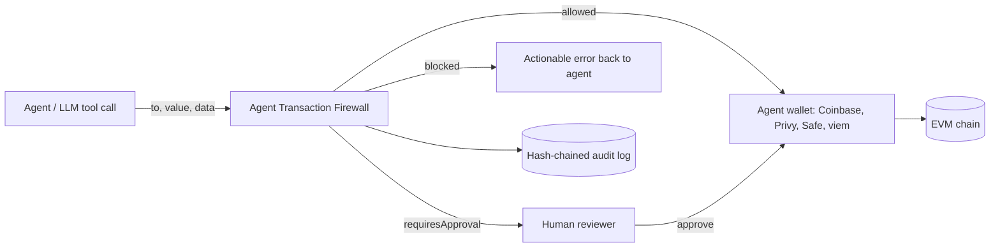

# Agent Transaction Firewall

A pre-execution safety and risk gate for autonomous onchain agents. Every EVM transaction an agent proposes is decoded down to the asset level, checked against a deterministic policy, explained in plain English, and recorded in a tamper-evident audit log **before** it reaches the agent wallet (Coinbase, Privy, Safe, viem, or any signer).

```
verdict: "allowed" | "blocked" | "requiresApproval"
```

**Why:** most agent value moves as ERC-20 calldata with `value = 0`. Gates that only look at native ETH value see a $5M USDC transfer, an unlimited `approve`, or `setApprovalForAll` to a drainer as a harmless zero-value call.

## Where it sits



> **The firewall is only a boundary if the agent cannot reach the wallet any other way.** Run it in the service that holds the wallet credentials (signing service, API gateway, or MCP tool server), not inside the same sandbox as the agent's private key. Keep wallet-native controls (Safe guards, provider policy engines, onchain session limits) as a second layer.

## Quick start

```sh
npm install
npm run check   # typecheck + tests + build
```

```ts
import { createFirewall, guard, parseUnits } from 'agent-transaction-firewall';

const firewall = createFirewall({ policy: {
  version: 1, chainIds: [8453],
  native: { perTransactionMax: parseUnits('0.05', 18), sessionMax: parseUnits('0.2', 18) },
  tokens: [{ address: USDC, symbol: 'USDC', decimals: 6, perTransactionMax: parseUnits('500', 6), sessionMax: parseUnits('2000', 6) }],
}});
const send = guard((tx) => wallet.sendTransaction(tx), { firewall, chainId: 8453, from: wallet.address });
await send({ to: USDC, data }); // throws FirewallBlockedError / ApprovalRequiredError, or sends
```

Use `firewall.evaluate(tx)` directly when you want the verdict without sending anything (dry runs, agent self-checks, approval UIs).

## Verdicts

```jsonc
{
  "verdict": "blocked",
  "allowed": false,
  "riskScore": 100, "riskLevel": "critical",
  "summary": "BLOCKED — The agent wants to grant 0x8888… an UNLIMITED allowance for USDC (0x8335…) — it could move the entire balance at any time without another agent transaction. Blocked because: Unlimited allowance for USDC (0x8335…) to 0x8888…: the spender could drain the full balance at any time.",
  "reasons": [
    { "code": "UNLIMITED_APPROVAL", "outcome": "block", "severity": "critical", "path": "0",
      "message": "…", "remediation": "Approve only the exact amount the next operation needs" },
    { "code": "UNTRUSTED_SPENDER", "outcome": "requireApproval", "severity": "high", "path": "0", "message": "…" }
  ],
  "actions": [{ "type": "token_approval", "token": "0x8335…", "spender": "0x8888…", "amount": "115792…", "unlimited": true }],
  "spend": { "native": "0", "tokens": {} },
  "txDigest": "…", "policyHash": "…", "auditHash": "…", "durationMs": 0.09
}
```

(Addresses are shortened here for layout only. Real summaries print **full addresses**, because shortened forms are what address-poisoning attacks imitate.)

| Verdict | Meaning | What to do |
|---|---|---|
| `allowed` | Within every rule. Spend is **reserved** against the session. | Send, then `commit(verdict, { txHash })`. |
| `requiresApproval` | No hard violation, but a human must confirm (threshold, unknown contract, untrusted spender, …). | Show `summary`/`reasons`; call `approve(verdict, { approver })` or `reject`. |
| `blocked` | A hard rule failed, or the firewall could not evaluate safely. | Return `reasons[].remediation` to the agent. |

Verdicts are frozen, plain JSON (amounts are base-unit decimal strings). Policy outcomes alone decide the verdict; `riskScore` ranks severity for reviewers and never relaxes a decision.

### Fail-closed behavior

`evaluate()` never throws. Invalid input (`INVALID_REQUEST`), malformed or non-canonical calldata, decoder/engine/store exceptions (`EVALUATION_ERROR`) and audit write failures (`AUDIT_UNAVAILABLE`) all produce `blocked`. A failed audit write rolls back the reservation.

## What it decodes

| Category | Functions | Treatment |
|---|---|---|
| Native | value with empty calldata; value attached to any call | Summed across all calls against native caps |
| ERC-20 movement | `transfer`, `transferFrom` (including pulls from third parties), ERC-677 `transferAndCall`, EIP-3009 `transferWithAuthorization` | Counted against token caps |
| ERC-20 authority | `approve`, `increaseAllowance`, EIP-2612 `permit`, Permit2 `approve` (canonical address only) | Unlimited (≥ 2¹²⁸) → **blocked**; finite → counted against caps; spender must be trusted |
| Revocations | `approve(…, 0)`, `decreaseAllowance`, `setApprovalForAll(…, false)` | Allowed |
| NFTs | ERC-721 `transferFrom`/`safeTransferFrom`/`approve`, ERC-1155 single/batch transfers, `setApprovalForAll` | Collection rules; operator approvals to untrusted operators blocked by default |
| Smart-wallet wrappers | `execute(address,uint256,bytes)` and `executeBatch((address,uint256,bytes)[])` called on the agent's own wallet | Unwrapped recursively (depth-limited); other self-calls → **blocked** |
| Other | Unknown selectors, fallback calls, contract deployment | Policy modes (default: approval / approval / blocked) |

`transferFrom` and `approve` share selectors between ERC-20 and ERC-721. Contracts listed in `nfts` are decoded as ERC-721; everything else is treated as ERC-20, and unlisted contracts go through the `unlistedAssets` rule with the ambiguity stated in the explanation.

Decoding is **canonical-only**. The strict ABI codec re-encodes every decoded call and requires a byte-for-byte match, so dirty address bits, trailing bytes, odd offsets and non-zero padding are blocked rather than interpreted. A recognized selector with bad arguments is never downgraded to an "unknown call".

## Policy

Policies are validated with strict Zod schemas at startup. Unknown keys, overlaps (an address configured as both a token and a protocol) and allow/deny conflicts throw `PolicyValidationError`. Amounts are base units (bigint, decimal or hex string); `parseUnits` converts human amounts.

```ts
const policy = definePolicy({
  version: 1,
  chainIds: [8453],
  native: { perTransactionMax: parseUnits('0.05', 18), sessionMax: parseUnits('0.2', 18), requireApprovalAbove: parseUnits('0.02', 18) },
  tokens: [
    { address: USDC, symbol: 'USDC', decimals: 6,
      perTransactionMax: parseUnits('500', 6), sessionMax: parseUnits('2000', 6),
      requireApprovalAbove: parseUnits('100', 6), maxApproval: parseUnits('500', 6) },
    { address: WETH, symbol: 'WETH', decimals: 18, perTransactionMax: parseUnits('0.1', 18), sessionMax: parseUnits('0.5', 18),
      allowedFunctions: ['0xd0e30db0', '0x2e1a7d4d'] }, // deposit(), withdraw(uint256)
  ],
  protocols: [{ name: 'Uniswap SwapRouter02', address: ROUTER, selectors: ['0x04e45aaf'], maxNativeValue: parseUnits('0.05', 18) }],
  approvals: { spenders: [PERMIT2_ADDRESS], unknownSpender: 'requireApproval', operatorApprovals: 'block' },
  recipients: { allow: [TREASURY, VENDOR], notAllowlisted: 'requireApproval' },
  denylist: [KNOWN_DRAINER],
  unlistedAssets: 'requireApproval',
  unknownContractCalls: 'requireApproval',
  contractDeployment: 'block',
  session: { maxDurationSeconds: 3600, maxTransactions: 50 },
  limits: { maxCalls: 16, maxNestingDepth: 2, maxCalldataBytes: 131072 },
  approvalTtlSeconds: 900,
});
```

Accounting rules worth knowing:

- **Per-transaction caps apply to the whole request.** Batched or nested calls are summed, so splitting one transfer into many calls doesn't evade the cap.
- **Finite approvals count as spend when granted.** Once approved, a spender (router, Permit2, marketplace) can move the funds without another agent transaction, so the grant is the last point the firewall can enforce. Re-approving the same spender is counted again; this is deliberately conservative.
- **Third-party pulls count.** `transferFrom` and EIP-3009 transfers out of a treasury count against limits even though the funds don't leave the agent wallet.
- Allowlisted protocols are trusted spenders automatically. Tokens and collections cannot also be protocols, because unrestricted selectors would bypass their limits; use `allowedFunctions` instead.

## Sessions, approvals and reservations

A session is a budget scope (for example, one agent run): `evaluate(tx, { sessionId })`. It starts on first use.

1. An `allowed` evaluation atomically checks caps and **reserves** the spend, so concurrent requests can't both pass a cap that only one fits under.
2. After sending, call `commit(verdict, { txHash })`. If the send fails **and you know nothing was broadcast**, call `release(verdict)`. `guard()` does this automatically, and keeps the reservation on ambiguous errors such as timeouts unless `releaseOnError` says otherwise.
3. `approve(verdict, { approver, note })` is bound to the evaluated transaction digest, can be used once, expires after `approvalTtlSeconds`, and re-checks caps against current usage before reserving. Hard rules can't be approved away.

`MemorySessionStore` serves one process. For multiple instances, implement `SessionStore.transact()` with a real lock or compare-and-swap (Redis `WATCH`/`MULTI`, a database row lock). The interface requires atomic, all-or-nothing persistence.

## Audit log

Every evaluation, approval, rejection, commit and release is appended as a SHA-256 hash-chained record containing the policy hash, transaction digest, normalized request, decoded actions, findings and verdict. No secrets are involved: inputs are public transaction fields.

```ts
import { JsonlFileAuditSink, verifyAuditChain } from 'agent-transaction-firewall';
const audit = new JsonlFileAuditSink('/var/log/agent-firewall/audit.jsonl'); // continues the chain after restart
const firewall = createFirewall({ policy, audit });
verifyAuditChain(await JsonlFileAuditSink.read(audit.path)); // { valid: true } or the first broken record
```

The chain makes edits, deletions and reordering **detectable**. Making them **impossible** needs WORM/object-lock storage, or periodically anchoring the head hash outside the host. The default in-memory sink is for development only and grows without bound. Implement `AuditSink` for your log pipeline; if `append` rejects, the request is blocked.

## Wallet integrations

`guard(send, options)` wraps any async send function. By default it reads `{ to, value, data }` or `{ calls: [...] }`; use `toCalls` for other shapes. The examples below are integration patterns: check each vendor SDK's current types.

```ts
// viem / Coinbase AgentKit-style wallet providers ({ to, value, data } in, hash out)
const send = guard((tx) => walletClient.sendTransaction({ account, chain, ...tx }), { firewall, chainId: 8453, from: account.address });

// Safe (Protocol Kit): gate the batch before creating the Safe transaction
const propose = guard((txs) => safe.createTransaction({ transactions: txs }), {
  firewall, chainId: 8453, from: safeAddress, toCalls: (txs) => txs,
});

// Privy, Coinbase CDP or any other API: wrap the function your code already calls
const sendViaProvider = guard((tx) => provider.sendTransaction(tx), {
  firewall, chainId: 8453, from: agentWalletAddress,
  onApprovalRequired: async (verdict) => ((await askHuman(verdict.summary)) ? { approver: 'oncall@example.com' } : false),
  releaseOnError: (e) => isDefinitelyNotBroadcast(e),
});
```

For EIP-4337 or EIP-7702 smart accounts, evaluate the **inner calls** (`calls: [...]`) with `from` set to the account address. Calls the agent makes to its own account through `execute`/`executeBatch` are unwrapped automatically.

Optional simulation: `createFirewall({ simulator: createRpcSimulator({ url }) })` runs an `eth_call` revert check only for requests that aren't already blocked. Reverts are blocked; RPC failures and batches apply `policy.simulation.onUnavailable`. Treat RPC URLs containing API keys as secrets.

## Security model and limitations

- **Typed-data signatures are out of scope.** Off-chain signatures (EIP-2612/Permit2 permits, EIP-712 marketplace orders, `personal_sign`) can authorize transfers without a transaction. Gate your wallet's `signTypedData`/`signMessage` paths separately, or deny them for agents.
- **No balance-diff simulation.** The engine judges declared intent from calldata; the optional `eth_call` check catches reverts, not hidden side effects. An allowlisted protocol can still move tokens within allowances already granted, which is why approvals are budgeted and spenders must be trusted.
- **Unknown calls are unverified by definition.** Their default is `requiresApproval`; use `'block'` for unattended agents.
- **USD-denominated limits are not built in.** Limits are per token in base units, which keeps decisions deterministic and oracle-free.
- **The defaults are single-process.** Sessions and the default audit sink are in memory; use durable implementations for production.
- This is a policy-enforcement layer, not a substitute for contract audits, key management or wallet-level controls.

## Development

| Command | Purpose |
|---|---|
| `npm test` | Vitest suite (ABI strictness, decoder, policy edge cases, concurrency, approvals, audit tampering, middleware, simulator) |
| `npm run typecheck` | Strict TypeScript (`exactOptionalPropertyTypes`, `noUncheckedIndexedAccess`) |
| `npm run build` | Emit ESM + declarations to `dist/` |
| `npm run bench` | Latency percentiles for `evaluate()` with in-memory stores |

Measured on a single-vCPU development VM (Node 22, n=5000, in-memory stores): single ERC-20 transfer p50 0.10 ms / p95 0.23 ms; 8-call batch p50 0.23 ms / p95 0.28 ms. Durable audit sinks and remote session stores add their own I/O latency.

### Layout

```
src/abi.ts         strict canonical ABI codec
src/decoder.ts     calldata → asset-level actions
src/engine.ts      deterministic rules, limits, risk score, verdict
src/explain.ts     plain-English descriptions
src/firewall.ts    validation, reservations, approvals, fail-closed orchestration
src/middleware.ts  guard() wrapper and typed errors
src/session.ts     session store interface + in-memory implementation
src/audit.ts       hash-chained audit log and sinks
src/simulation.ts  optional eth_call simulator
src/schemas.ts     Zod schemas for requests and policies
```

### Provenance

The decoding and scoring approach is derived from ATF's `packages/compiler/risk/calldata.ts` and `risk/scoring.ts` (token-aware decoding, unlimited-approval detection, dominant-signal score aggregation). It deliberately differs where those modules failed open: unknown or malformed calldata no longer falls back to native-value-only scoring, decoding is canonical-only, batches are aggregated, and multi-chain/ZK abstractions are removed.
